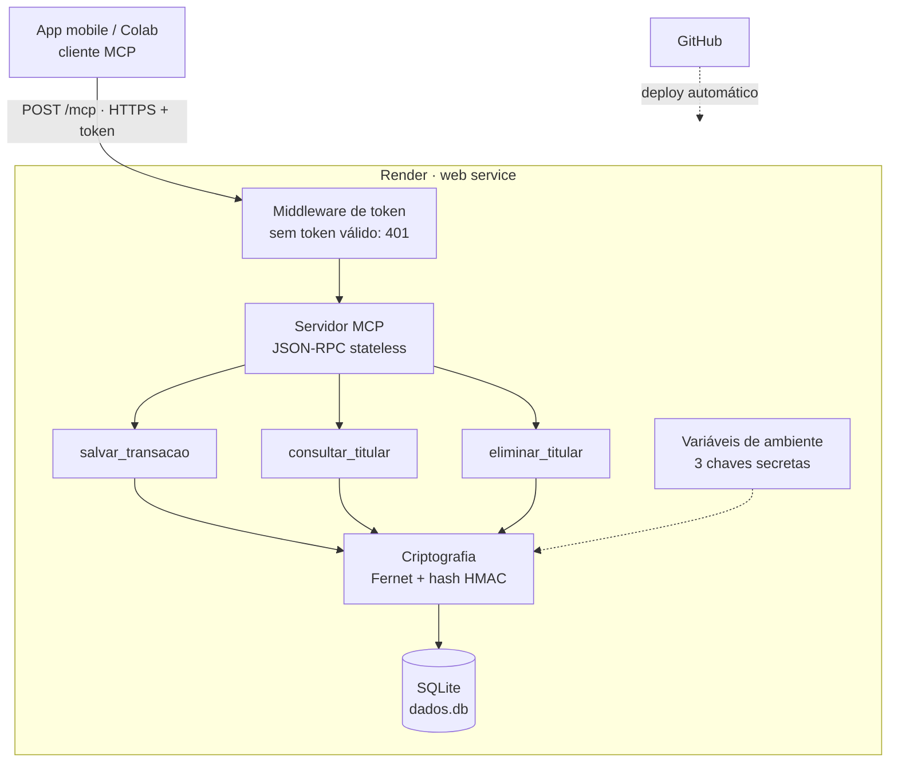

# Prisma

Ferramenta de organização financeira baseada em agentes de IA.

O projeto parte de uma pergunta: a inteligência artificial vai **substituir** o humano ou **ampliar** o seu potencial? O Prisma explora a segunda hipótese, com agentes que ajudam a pessoa a registrar e entender a própria vida financeira, sem tirar dela o controle sobre os seus dados.

> **Status:** em desenvolvimento (MVP). Neste momento o repositório contém o primeiro agente, responsável por guardar dados financeiros com segurança.

---

## Sumário

- [Arquitetura](#arquitetura)
- [Agente de armazenamento (`agente-simples`)](#agente-de-armazenamento-agente-simples)
- [Segurança e LGPD](#segurança-e-lgpd)
- [Como rodar localmente](#como-rodar-localmente)
- [Deploy no Render](#deploy-no-render)
- [Como testar](#como-testar)
- [Estrutura do repositório](#estrutura-do-repositório)
- [Requisitos do projeto](#requisitos-do-projeto)
- [Limitações conhecidas](#limitações-conhecidas)
- [Próximos passos](#próximos-passos)

---

## Arquitetura

O cliente (app mobile ou notebook de teste) conversa com o agente usando o **MCP (Model Context Protocol)** sobre HTTPS. O agente valida o token, executa a ferramenta pedida, criptografa os dados e grava em SQLite.



---

## Agente de armazenamento (`agente-simples`)

Servidor MCP que guarda dados de transações financeiras em **qualquer formato JSON**, sempre criptografados.

### Ferramentas MCP

| Ferramenta | Parâmetros | O que faz |
|---|---|---|
| `salvar_transacao` | `titular_id`, `dados` | Guarda o JSON da transação, criptografado |
| `consultar_titular` | `titular_id` | Retorna todos os registros do titular, descriptografados |
| `eliminar_titular` | `titular_id` | Apaga todos os registros do titular |

Além disso, `GET /health` responde `{"status": "ok"}` sem exigir token, para o monitoramento do Render.

### Exemplo de chamada

```http
POST /mcp
Authorization: Bearer <MCP_TOKEN>
Content-Type: application/json
Accept: application/json, text/event-stream

{
  "jsonrpc": "2.0",
  "id": 1,
  "method": "tools/call",
  "params": {
    "name": "salvar_transacao",
    "arguments": {
      "titular_id": "000.000.000-00",
      "dados": { "tipo": "pix", "valor": -150.75, "descricao": "Mercado" }
    }
  }
}
```

Resposta:

```json
{"jsonrpc": "2.0", "id": 1, "result": {"content": [{"type": "text", "text": "{\"status\": \"ok\", \"id\": 1}"}], "isError": false}}
```

### Tecnologias

- Python 3.12
- [MCP Python SDK](https://github.com/modelcontextprotocol/python-sdk) 2.x (transporte Streamable HTTP)
- `cryptography` (Fernet)
- SQLite
- Uvicorn
- Render (hospedagem)

---

## Segurança e LGPD

| Medida | Como foi implementada |
|---|---|
| Criptografia em trânsito | HTTPS fornecido pelo Render |
| Criptografia em repouso | Conteúdo de cada registro cifrado com Fernet (AES + HMAC) |
| Pseudonimização | O CPF/ID do titular nunca é gravado; só um hash HMAC-SHA256 |
| Controle de acesso | Token obrigatório em `Authorization: Bearer`, comparado em tempo constante |
| Proteção de host | Só aceita requisições para o domínio do serviço (proteção contra DNS rebinding) |
| Logs | Logs de acesso desligados (`--no-access-log`) para não expor dados |
| Direito de acesso (art. 18, II) | Ferramenta `consultar_titular` |
| Direito de eliminação (art. 18, VI) | Ferramenta `eliminar_titular` |

> ⚠️ Estas medidas técnicas **não garantem sozinhas** a conformidade com a LGPD. Base legal, política de privacidade, prazo de retenção, transferência internacional de dados (o Render hospeda fora do Brasil) e plano de resposta a incidentes também precisam ser definidos antes de usar dados reais.

### Variáveis de ambiente

| Variável | Para que serve |
|---|---|
| `MCP_TOKEN` | Token que o cliente envia para acessar o agente |
| `ENCRYPTION_KEY` | Chave Fernet que cifra os dados |
| `HASH_KEY` | Chave do hash HMAC que pseudonimiza o titular |
| `DB_PATH` | (opcional) Caminho do banco. Padrão: `dados.db` |

Para gerar as chaves:

```python
from cryptography.fernet import Fernet
import secrets

print("ENCRYPTION_KEY =", Fernet.generate_key().decode())
print("HASH_KEY       =", secrets.token_urlsafe(48))
print("MCP_TOKEN      =", secrets.token_urlsafe(48))
```

> 🔒 **Nunca** faça commit das chaves, nem as coloque em código, prints ou issues. Guarde `ENCRYPTION_KEY` e `HASH_KEY` em um gerenciador de senhas: se forem perdidas, os dados não podem mais ser lidos.

---

## Como rodar localmente

```bash
git clone https://github.com/kelsbor/Prisma.git
cd Prisma/agente-simples

python -m venv .venv
source .venv/bin/activate        # Windows: .venv\Scripts\activate
pip install -r requirements.txt

export MCP_TOKEN="..."           # gere conforme a seção acima
export ENCRYPTION_KEY="..."
export HASH_KEY="..."

uvicorn app:app --reload --no-access-log
```

- Health check: http://localhost:8000/health
- Endpoint MCP: http://localhost:8000/mcp

---

## Deploy no Render

O arquivo [`render.yaml`](render.yaml) na raiz já descreve o serviço (com `rootDir: agente-simples`).

1. No Render, clique em **New → Blueprint** e selecione este repositório.
2. Preencha `MCP_TOKEN`, `ENCRYPTION_KEY` e `HASH_KEY` quando solicitado.
3. Aguarde o deploy e acesse `https://<seu-servico>.onrender.com/health`.

A cada `git push` na branch `main`, o Render faz um novo deploy automaticamente.

---

## Como testar

No [Google Colab](https://colab.research.google.com/):

1. No ícone de chave 🔑 (Secrets), crie o secret `MCP_TOKEN` com o valor do token e libere o acesso do notebook.
2. Rode a célula abaixo, trocando a URL pela do seu serviço:

```python
import requests
from google.colab import userdata

URL = "https://<seu-servico>.onrender.com"
TOKEN = userdata.get("MCP_TOKEN")   # nome do secret, não o valor
TITULAR = "000.000.000-00"          # sempre dado fictício em testes

def chamar(ferramenta, argumentos):
    resp = requests.post(
        f"{URL}/mcp",
        headers={"Authorization": f"Bearer {TOKEN}",
                 "Content-Type": "application/json",
                 "Accept": "application/json, text/event-stream"},
        json={"jsonrpc": "2.0", "id": 1, "method": "tools/call",
              "params": {"name": ferramenta, "arguments": argumentos}},
        timeout=90,
    )
    print(f"\n=== {ferramenta} (HTTP {resp.status_code}) ===")
    print(resp.json()["result"]["content"][0]["text"] if resp.ok else resp.text)

print("health:", requests.get(f"{URL}/health", timeout=90).json())
chamar("salvar_transacao", {"titular_id": TITULAR, "dados": {"tipo": "pix", "valor": -150.75}})
chamar("consultar_titular", {"titular_id": TITULAR})
chamar("eliminar_titular", {"titular_id": TITULAR})

r = requests.post(f"{URL}/mcp", headers={"Authorization": "Bearer errado"}, json={}, timeout=90)
print("\nToken errado ->", r.status_code, "(esperado: 401)")
```

**Resultado esperado:** `health` ok, as três ferramentas com HTTP 200 e `Token errado -> 401`.

---

## Estrutura do repositório

```
Prisma/
├── README.md
├── render.yaml              # configuração de deploy (Render Blueprint)
└── agente-simples/
    ├── app.py               # servidor MCP: ferramentas, criptografia, SQLite e token
    ├── requirements.txt
    ├── render.yaml          # cópia antiga (o Render usa o da raiz)
    └── .gitignore
```

---

## Requisitos do projeto

| Requisito | Situação |
|---|---|
| Pelo menos 2 agentes trabalhando juntos | 🟡 1 de 2 (agente de armazenamento pronto) |
| Base de conhecimento | ⬜ Pendente |
| Aplicar MLOps | ⬜ Pendente (deploy contínuo via GitHub + Render já configurado) |
| Construir e testar uma rede neural simples | ⬜ Pendente |
| Uso de API por meio dos agentes | ✅ Agente expõe API via MCP sobre HTTPS |
| Ferramenta de versionamento de código | ✅ Git + GitHub |
| Solução ética e explicável | 🟡 Em andamento (privacidade e LGPD aplicadas no armazenamento) |
| Pelo menos 1 referência com até 2 anos de publicação | ⬜ Pendente |
| MVP funcional | 🟡 Em andamento |

---

## Limitações conhecidas

- **Dados temporários no plano gratuito.** Sem disco persistente, o `dados.db` é apagado a cada deploy ou reinício. Use apenas dados fictícios.
- **Primeira chamada lenta.** No plano gratuito o serviço "dorme" após cerca de 15 minutos sem uso; a primeira requisição pode levar até 1 minuto.
- **Token único.** Todos os clientes usam o mesmo `MCP_TOKEN` e informam o `titular_id`. Isso serve para testes, mas **não deve ir para produção**: o token pode ser extraído do app e daria acesso aos dados de qualquer titular.
- **Sem validação dos dados.** O agente aceita qualquer JSON em `dados`.

---

## Próximos passos

- [ ] Login por usuário (token individual) e titular obtido do login, não de parâmetro
- [ ] Disco persistente ou banco gerenciado para dados reais
- [ ] Segundo agente (análise e explicação dos gastos)
- [ ] Base de conhecimento
- [ ] Rede neural simples (ex.: classificação de categorias de gasto)
- [ ] Pipeline de MLOps (testes automatizados, versionamento de modelo, monitoramento)
- [ ] Ferramentas de correção e portabilidade de dados (LGPD art. 18, III e V)
- [ ] Política de retenção e exclusão automática
