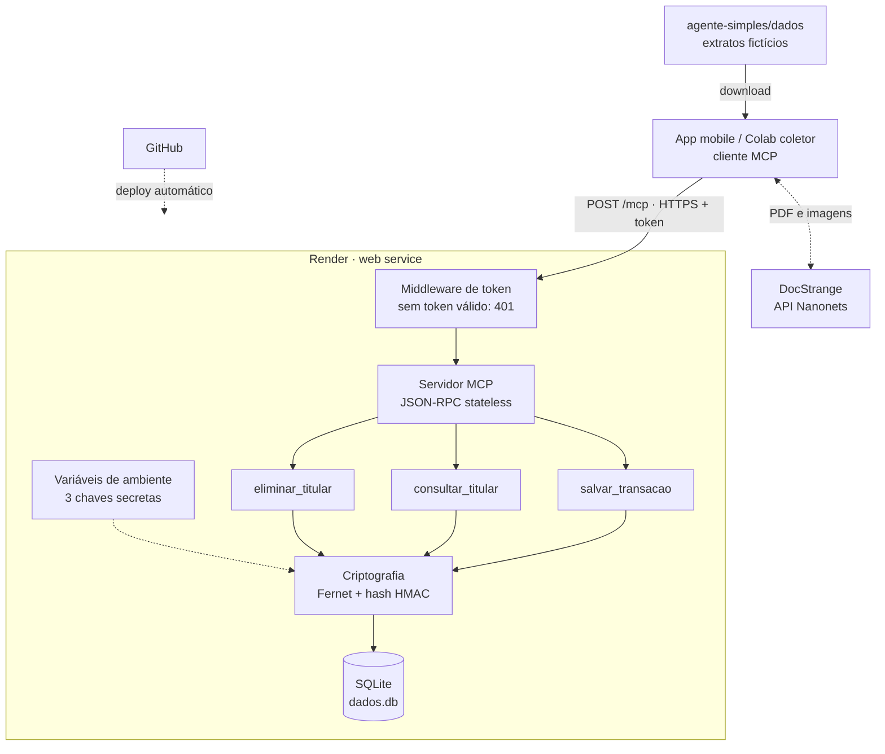
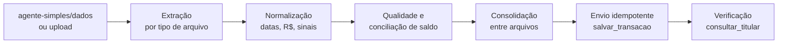

# Prisma

Ferramenta de organização financeira baseada em agentes de IA.

O projeto parte de uma pergunta: a inteligência artificial vai **substituir** o humano ou **ampliar** o seu potencial? O Prisma explora a segunda hipótese, com agentes que ajudam a pessoa a registrar e entender a própria vida financeira, sem tirar dela o controle sobre os seus dados.

> **Status:** em desenvolvimento (MVP). Neste momento o repositório contém o agente de armazenamento, que guarda dados financeiros com segurança, e o coletor de extratos, um notebook que lê extratos em vários formatos e grava as transações no agente.

---

## Sumário

- [Sobre o projeto](#sobre-o-projeto)

- [Arquitetura](#arquitetura)
- [Agente de armazenamento (`agente-simples`)](#agente-de-armazenamento-agente-simples)
- [Coletor de extratos (notebook)](#coletor-de-extratos-notebook)
- [Segurança e LGPD](#segurança-e-lgpd)
- [Como rodar localmente](#como-rodar-localmente)
- [Deploy no Render](#deploy-no-render)
- [Como testar](#como-testar)
- [Estrutura do repositório](#estrutura-do-repositório)
- [Requisitos do projeto](#requisitos-do-projeto)
- [Validação](#validação)
- [Limitações conhecidas](#limitações-conhecidas)
- [Próximos passos](#próximos-passos)

---

## Sobre o projeto

| | |
|---|---|
| **Grupo** | Prisma |
| **Integrantes** | Alvaro, Carlos, Kelvin, Mariana, Prisciele, William |
| **Big Idea** | Bem-estar |
| **Essential Question** | A IA vai substituir o humano ou ampliar seu potencial? |
| **Versão da documentação** | 1.0 (30/10/2026) |

**Problema.** Boa parte da população tem dificuldade em planejar as finanças, por falta de conhecimento ou de tempo para manter planilhas com pequenos gastos. Sem controle, o dinheiro vira fonte de estresse, ansiedade e culpa no dia a dia.

**Público-alvo.** Pessoas que movimentam o próprio dinheiro, independentemente de renda, idade ou profissão, incluindo quem controla as finanças de cabeça e quem não controla.

**Hipótese.** O agente amplia o potencial humano em vez de substituí-lo. Ele assume a parte mecânica (registrar, categorizar, somar, lembrar), e as decisões continuam com o usuário: o que cortar, qual meta seguir, quando pagar uma dívida. Ao explicar o raciocínio de cada sugestão, o agente ensina educação financeira na prática.

### Agentes

| Agente | Função principal | Situação |
|---|---|---|
| Coletor de extratos | Lê extratos em vários formatos, padroniza, confere a qualidade e envia as transações ao armazenamento | ✅ Funcionando como notebook no Colab |
| Armazenamento (`agente-simples`) | Guarda, consulta e apaga transações por titular, criptografadas, via MCP | ✅ Publicado no Render |
| Análise e explicação | Categoriza os gastos e explica ao usuário para onde o dinheiro vai, com um LLM | ⬜ Planejado |

O Agente de Armazenamento é um **agente reativo simples**: cada chamada é mapeada direto para uma ação fixa, sem modelo de mundo, objetivos ou aprendizado. Ele funciona como provedor de ferramentas para os outros agentes.

---

## Arquitetura

O cliente (app mobile ou o notebook coletor) conversa com o agente usando o **MCP (Model Context Protocol)** sobre HTTPS. O agente valida o token, executa a ferramenta pedida, criptografa os dados e grava em SQLite.



---

## Agente de armazenamento (`agente-simples`)

Servidor MCP que guarda dados de transações financeiras em **qualquer formato JSON**, sempre criptografados.

### Ferramentas MCP

| Ferramenta | Parâmetros | O que faz |
|---|---|---|
| `salvar_transacao` | `titular_id`, `dados` | Guarda o JSON da transação, criptografado |
| `consultar_titular` | `titular_id` | Retorna todos os registros do titular, descriptografados |
| `eliminar_titular` | `titular_id` | Apaga todos os registros do titular |

Além disso, `GET /health` responde `{"status": "ok"}` sem exigir token, para o monitoramento do Render.

### Exemplo de chamada

```http
POST /mcp
Authorization: Bearer <MCP_TOKEN>
Content-Type: application/json
Accept: application/json, text/event-stream

{
  "jsonrpc": "2.0",
  "id": 1,
  "method": "tools/call",
  "params": {
    "name": "salvar_transacao",
    "arguments": {
      "titular_id": "000.000.000-00",
      "dados": { "tipo": "pix", "valor": -150.75, "descricao": "Mercado" }
    }
  }
}
```

Resposta:

```json
{"jsonrpc": "2.0", "id": 1, "result": {"content": [{"type": "text", "text": "{\"status\": \"ok\", \"id\": 1}"}], "isError": false}}
```

### Tecnologias

- Python 3.12
- [MCP Python SDK](https://github.com/modelcontextprotocol/python-sdk) 2.x (transporte Streamable HTTP)
- `cryptography` (Fernet)
- SQLite
- Uvicorn
- Render (hospedagem)

---

## Coletor de extratos (notebook)

[](https://colab.research.google.com/github/kelsbor/Prisma/blob/main/agente-simples/dados/prisma_coletor_docstrange_mcp.ipynb)

O notebook [`prisma_coletor_docstrange_mcp.ipynb`](agente-simples/dados/prisma_coletor_docstrange_mcp.ipynb) roda no Google Colab. Ele lê extratos bancários em vários formatos, padroniza as transações, confere a qualidade dos dados e grava tudo no agente de armazenamento pela ferramenta `salvar_transacao`.

Por padrão, a entrada é a pasta [`agente-simples/dados`](agente-simples/dados), a mesma onde fica o notebook. Qualquer extrato novo colocado nela entra na próxima execução; o próprio `.ipynb` é ignorado.

### Fluxo



### Formatos aceitos

| Formato | Como é lido |
|---|---|
| PDF, PNG/JPG/TIFF/BMP/GIF, DOCX, PPTX, HTML | [DocStrange](https://github.com/NanoNets/docstrange) (OCR + extração com esquema JSON) |
| CSV, TSV, TXT delimitado, XLSX/XLS, OFX | Leitura local e determinística, sem enviar o arquivo para fora |
| PDF com camada de texto, se o DocStrange falhar | Fallback local com `pypdf` |

### Dados de teste (`agente-simples/dados`)

Os três arquivos representam o **mesmo extrato fictício** (Banco Fictício S.A., 01/08/2026 a 31/10/2026, saldo inicial R$ 845,12 e final R$ 503,68), em formatos diferentes e com inconsistências de propósito, para testar o coletor:

| Arquivo | Formato | Particularidades |
|---|---|---|
| `extrato_ficticio_prisma.png` | Imagem do extrato, com coluna de saldo | Datas sem ano (`01/08`), valores como `-R$ 1.384,62`, descrição da Uber diferente das outras fontes |
| `extrato_ficticio_csv.pdf` | PDF com o CSV impresso | Separador `,` e decimal `.` |
| `extrato_limpo_excel_csv.txt` | CSV exportado do Excel | Separador `;` e decimal `,`; **não tem** a cobrança duplicada do iFood (03/09) nem o estorno dela (14/09) |

Inconsistências presentes nos dados: cobrança duplicada seguida de estorno, PIX de teste de R$ 0,01, erro de digitação (`PAG*IFOD`), estorno de compra, saldo negativo com juros e IOF de cheque especial.

### Checagens de qualidade

Nada é corrigido automaticamente. Os problemas viram **alertas** gravados junto da transação, para que a decisão seja explicável:

| Alerta | Significado |
|---|---|
| `repetido_no_mesmo_dia` | Mesmo lançamento duas vezes. É mantido, porque pode ser uma cobrança dupla real |
| `valor_irrisorio` | Valor abaixo de R$ 1,00 (ex.: PIX de teste) |
| `descricao_parecida_com:X` | Possível erro de digitação em relação a uma descrição frequente |
| `estorna:<data>` | Estorno ligado ao débito original |
| Conciliação | Saldo inicial + movimentos = saldo final, e saldo linha a linha quando o extrato traz a coluna de saldo |

### Consolidação e idempotência

- **Chave da transação:** hash de `data + valor + ordem no dia`. A descrição não entra, porque muda entre fontes (`DL*UBERRIDES` no CSV, `UBER* TRIP HELP.UBER.COM` na imagem).
- **Fonte preferida:** a descrição gravada vem da fonte mais confiável (CSV/OFX > planilha/TXT > PDF > imagem). As demais ficam em `descricoes_alternativas`.
- **Diferenças entre arquivos:** transações que aparecem em um arquivo e não em outro são listadas antes do envio.
- **Sem duplicar:** antes de gravar, o notebook consulta `consultar_titular` e envia só chaves novas. Rodar o notebook duas vezes não duplica nada.

### JSON gravado no agente

```json
{
  "data": "2026-09-14",
  "descricao": "ESTORNO PAG*IFOOD",
  "valor": 48.7,
  "moeda": "BRL",
  "chave": "…",
  "fontes": [
    {"arquivo": "extrato_ficticio_csv.pdf", "tipo": "pdf", "metodo": "fallback · texto do PDF (pypdf)"},
    {"arquivo": "extrato_ficticio_prisma.png", "tipo": "png", "metodo": "docstrange · json_schema"}
  ],
  "alertas": ["estorna:2026-09-03"],
  "ingerido_em": "2026-10-29T21:00:00+00:00",
  "coletor": "colab-docstrange-v1"
}
```

### Como usar

1. Abra o notebook no Colab pelo botão **Open in Colab** no início desta seção.
2. Crie os secrets no ícone 🔑: `MCP_TOKEN` (obrigatório), `NANONETS_API_KEY` (para PDF e imagens; chave grátis em [app.nanonets.com](https://app.nanonets.com/#/keys)) e, opcionalmente, `GITHUB_TOKEN`.
3. Na célula de configuração, preencha `URL_AGENTE` e `TITULAR_ID` (sempre fictício).
4. Rode tudo com `DRY_RUN = True` para conferir o que seria enviado.
5. Mude para `DRY_RUN = False` e rode de novo a etapa de envio.

**Resultado esperado com os dados de teste:** 79 transações únicas gravadas, nenhuma chave duplicada e soma de −341,44, igual à diferença entre o saldo final e o inicial do extrato.

### Consulta rápida da base

```python
import json, requests
import pandas as pd
from google.colab import userdata

URL_AGENTE = "https://agente-financeiro-i4qz.onrender.com"
TITULAR_ID = "000.000.000-00"

r = requests.post(f"{URL_AGENTE}/mcp", timeout=90,
                  headers={"Authorization": f"Bearer {userdata.get('MCP_TOKEN')}",
                           "Content-Type": "application/json",
                           "Accept": "application/json, text/event-stream"},
                  json={"jsonrpc": "2.0", "id": 1, "method": "tools/call",
                        "params": {"name": "consultar_titular",
                                   "arguments": {"titular_id": TITULAR_ID}}})

registros = json.loads(r.json()["result"]["content"][0]["text"])["registros"]
df = pd.DataFrame([reg["dados"] for reg in registros])
print(len(df), "registros")
df
```

---

## Segurança e LGPD

| Medida | Como foi implementada |
|---|---|
| Criptografia em trânsito | HTTPS fornecido pelo Render |
| Criptografia em repouso | Conteúdo de cada registro cifrado com Fernet (AES + HMAC) |
| Pseudonimização | O CPF/ID do titular nunca é gravado; só um hash HMAC-SHA256 |
| Controle de acesso | Token obrigatório em `Authorization: Bearer`, comparado em tempo constante |
| Proteção de host | Só aceita requisições para o domínio do serviço (proteção contra DNS rebinding) |
| Logs | Logs de acesso desligados (`--no-access-log`) para não expor dados |
| Direito de acesso (art. 18, II) | Ferramenta `consultar_titular` |
| Direito de eliminação (art. 18, VI) | Ferramenta `eliminar_titular` |
| Extração de documentos no coletor | CSV, XLSX e OFX são lidos localmente. PDF e imagens vão para a API do DocStrange (Nanonets, fora do Brasil), por isso esse modo é só para dados fictícios. Para dados reais, há o modo local com GPU |
| Dados de teste no repositório | A pasta `agente-simples/dados` é pública e contém **somente** extratos fictícios |

> ⚠️ Estas medidas técnicas **não garantem sozinhas** a conformidade com a LGPD. Base legal, política de privacidade, prazo de retenção, transferência internacional de dados (o Render hospeda fora do Brasil) e plano de resposta a incidentes também precisam ser definidos antes de usar dados reais.

### Variáveis de ambiente

| Variável | Para que serve |
|---|---|
| `MCP_TOKEN` | Token que o cliente envia para acessar o agente |
| `ENCRYPTION_KEY` | Chave Fernet que cifra os dados |
| `HASH_KEY` | Chave do hash HMAC que pseudonimiza o titular |
| `DB_PATH` | (opcional) Caminho do banco. Padrão: `dados.db` |

Para gerar as chaves:

```python
from cryptography.fernet import Fernet
import secrets

print("ENCRYPTION_KEY =", Fernet.generate_key().decode())
print("HASH_KEY       =", secrets.token_urlsafe(48))
print("MCP_TOKEN      =", secrets.token_urlsafe(48))
```

> 🔒 **Nunca** faça commit das chaves, nem as coloque em código, prints ou issues. Guarde `ENCRYPTION_KEY` e `HASH_KEY` em um gerenciador de senhas: se forem perdidas, os dados não podem mais ser lidos.

---

## Como rodar localmente

```bash
git clone https://github.com/kelsbor/Prisma.git
cd Prisma/agente-simples

python -m venv .venv
source .venv/bin/activate        # Windows: .venv\Scripts\activate
pip install -r requirements.txt

export MCP_TOKEN="..."           # gere conforme a seção acima
export ENCRYPTION_KEY="..."
export HASH_KEY="..."

uvicorn app:app --reload --no-access-log
```

- Health check: http://localhost:8000/health
- Endpoint MCP: http://localhost:8000/mcp

---

## Deploy no Render

O arquivo [`render.yaml`](render.yaml) na raiz já descreve o serviço (com `rootDir: agente-simples`).

1. No Render, clique em **New → Blueprint** e selecione este repositório.
2. Preencha `MCP_TOKEN`, `ENCRYPTION_KEY` e `HASH_KEY` quando solicitado.
3. Aguarde o deploy e acesse `https://<seu-servico>.onrender.com/health`.

A cada `git push` na branch `main`, o Render faz um novo deploy automaticamente.

---

## Como testar

No [Google Colab](https://colab.research.google.com/):

1. No ícone de chave 🔑 (Secrets), crie o secret `MCP_TOKEN` com o valor do token e libere o acesso do notebook.
2. Rode a célula abaixo, trocando a URL pela do seu serviço:

```python
import requests
from google.colab import userdata

URL = "https://<seu-servico>.onrender.com"
TOKEN = userdata.get("MCP_TOKEN")   # nome do secret, não o valor
TITULAR = "000.000.000-00"          # sempre dado fictício em testes

def chamar(ferramenta, argumentos):
    resp = requests.post(
        f"{URL}/mcp",
        headers={"Authorization": f"Bearer {TOKEN}",
                 "Content-Type": "application/json",
                 "Accept": "application/json, text/event-stream"},
        json={"jsonrpc": "2.0", "id": 1, "method": "tools/call",
              "params": {"name": ferramenta, "arguments": argumentos}},
        timeout=90,
    )
    print(f"\n=== {ferramenta} (HTTP {resp.status_code}) ===")
    print(resp.json()["result"]["content"][0]["text"] if resp.ok else resp.text)

print("health:", requests.get(f"{URL}/health", timeout=90).json())
chamar("salvar_transacao", {"titular_id": TITULAR, "dados": {"tipo": "pix", "valor": -150.75}})
chamar("consultar_titular", {"titular_id": TITULAR})
chamar("eliminar_titular", {"titular_id": TITULAR})

r = requests.post(f"{URL}/mcp", headers={"Authorization": "Bearer errado"}, json={}, timeout=90)
print("\nToken errado ->", r.status_code, "(esperado: 401)")
```

**Resultado esperado:** `health` ok, as três ferramentas com HTTP 200 e `Token errado -> 401`.

---

## Estrutura do repositório

```
Prisma/
├── README.md
├── render.yaml              # configuração de deploy (Render Blueprint)
└── agente-simples/
    ├── app.py               # servidor MCP: ferramentas, criptografia, SQLite e token
    ├── requirements.txt
    ├── render.yaml          # cópia antiga (o Render usa o da raiz)
    ├── .gitignore
    └── dados/               # extratos FICTÍCIOS e o coletor
        ├── prisma_coletor_docstrange_mcp.ipynb   # coletor de extratos (Colab)
        ├── extrato_ficticio_csv.pdf
        ├── extrato_ficticio_prisma.png
        └── extrato_limpo_excel_csv.txt
```

---

## Requisitos do projeto

| Requisito | Situação |
|---|---|
| Pelo menos 2 agentes trabalhando juntos | 🟡 Coletor e Armazenamento trabalhando juntos via MCP; coletor ainda como notebook; Análise planejado |
| Base de conhecimento | 🟡 Documentada (extratos fictícios, regras de limpeza e do formato bancário brasileiro); normalização de estabelecimentos pendente |
| Aplicar MLOps | ⬜ Pendente (deploy contínuo via GitHub + Render já configurado) |
| Construir e testar uma rede neural simples | ⬜ Pendente |
| Uso de API por meio dos agentes | ✅ Agente expõe API via MCP sobre HTTPS; coletor consome a API do DocStrange e a do agente |
| Ferramenta de versionamento de código | ✅ Git + GitHub |
| Solução ética e explicável | 🟡 Em andamento (privacidade e LGPD no armazenamento; alertas de qualidade explicáveis no coletor, sem correção automática) |
| Pelo menos 1 referência com até 2 anos de publicação | ⬜ Pendente |
| MVP funcional | 🟡 Coleta e armazenamento funcionando de ponta a ponta; análise pendente |

---

## Validação

Teste feito com os três extratos fictícios de `agente-simples/dados`, gravando no agente publicado no Render.

| Métrica | Meta | Resultado |
|---|---|---|
| Transações extraídas do extrato | 100% | 79 de 79 |
| Diferença na conciliação de saldo | R$ 0,00 | R$ 0,00 (soma −341,44 = 503,68 − 845,12) |
| Registros duplicados na base | 0 | 0, mesmo após duas execuções |
| Problemas plantados sinalizados com alerta | 100% | 5 de 5 (duplicidade, dois estornos, Pix de R$ 0,01, `PAG*IFOD`) |
| Correções feitas sem o usuário | 0 | 0 |
| Acesso sem token aceito | 0 | 0 (resposta 401) |

Saldo líquido por mês: −110,32 em agosto, +786,16 em setembro e −1.017,28 em outubro (com juros e IOF de cheque especial).

**Hipótese: parcialmente confirmada.** A parte mecânica foi automatizada sem digitação manual, e nenhum dado foi corrigido ou apagado sozinho: cada problema virou um alerta explicado. A confirmação completa depende do Agente de Análise, que vai explicar os gastos ao usuário.

---

## Limitações conhecidas

- **Dados temporários no plano gratuito.** Sem disco persistente, o `dados.db` é apagado a cada deploy ou reinício. Use apenas dados fictícios.
- **Primeira chamada lenta.** No plano gratuito o serviço "dorme" após cerca de 15 minutos sem uso; a primeira requisição pode levar até 1 minuto.
- **Token único.** Todos os clientes usam o mesmo `MCP_TOKEN` e informam o `titular_id`. Isso serve para testes, mas **não deve ir para produção**: o token pode ser extraído do app e daria acesso aos dados de qualquer titular.
- **Sem validação dos dados.** O agente aceita qualquer JSON em `dados`.
- **Coletor sem chave da Nanonets.** Sem `NANONETS_API_KEY`, imagens não são lidas e PDFs só funcionam se tiverem camada de texto.
- **Consolidação assume a mesma conta.** Todos os arquivos processados juntos são tratados como extratos da mesma conta.
- **Envio uma a uma.** O agente não tem gravação em lote nem busca por chave; o coletor faz uma chamada por transação e lê a base inteira do titular para evitar duplicatas.

---

## Próximos passos

- [ ] Login por usuário (token individual) e titular obtido do login, não de parâmetro
- [ ] Disco persistente ou banco gerenciado para dados reais
- [ ] Transformar o coletor em agente MCP próprio, conversando com o agente de armazenamento
- [ ] Ferramentas `salvar_lote` e gravação por chave (upsert) no agente de armazenamento
- [ ] Agente de Análise e Explicação (categorização com LLM; modelo e provedor a definir)
- [ ] Normalização de estabelecimentos (ex.: `DL*UBERRIDES`, `UBER *TRIP` → "Uber")
- [ ] Base de conhecimento
- [ ] Rede neural simples (ex.: classificação de categorias de gasto)
- [ ] Pipeline de MLOps (testes automatizados, versionamento de modelo, monitoramento)
- [ ] Ferramentas de correção e portabilidade de dados (LGPD art. 18, III e V)
- [ ] Política de retenção e exclusão automática
