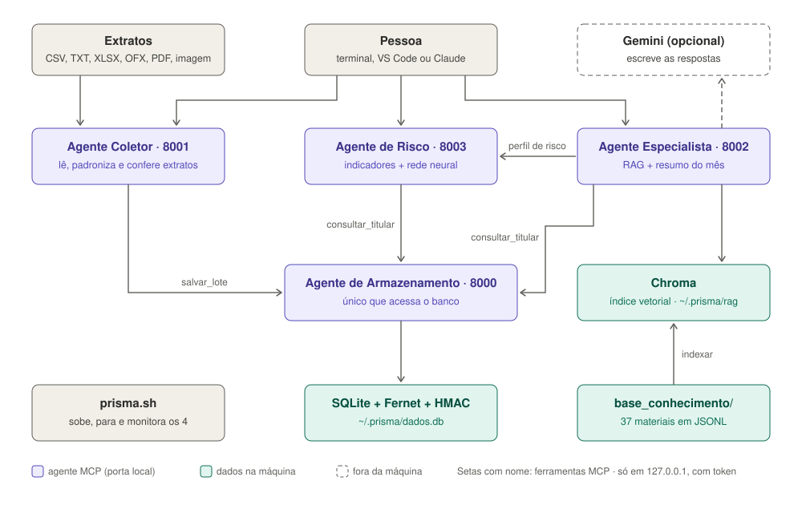
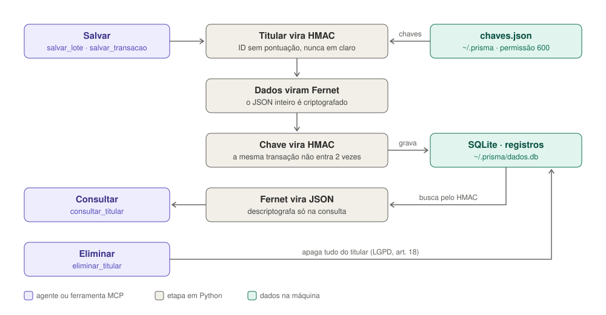
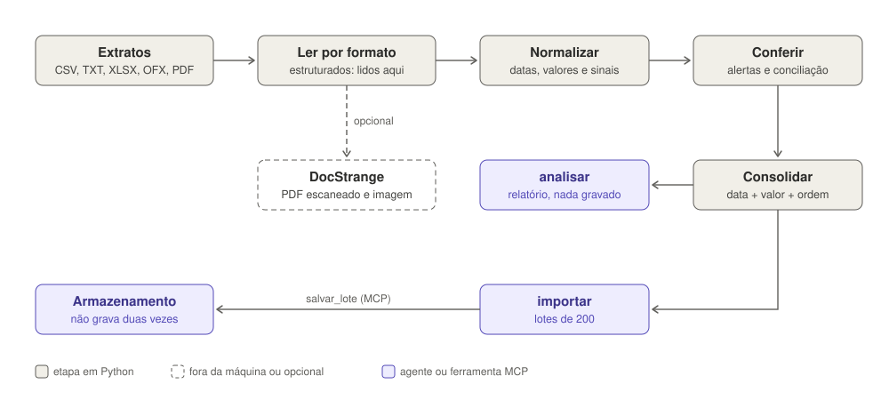
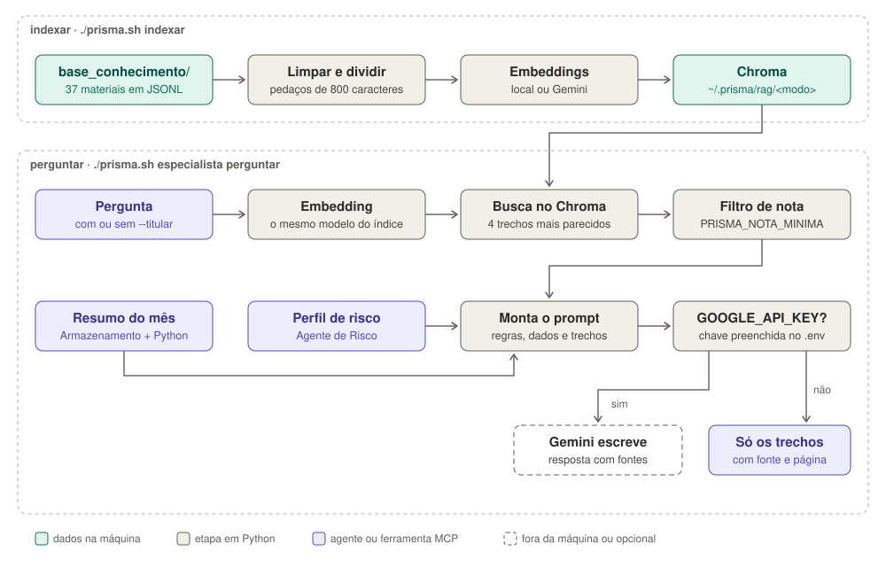
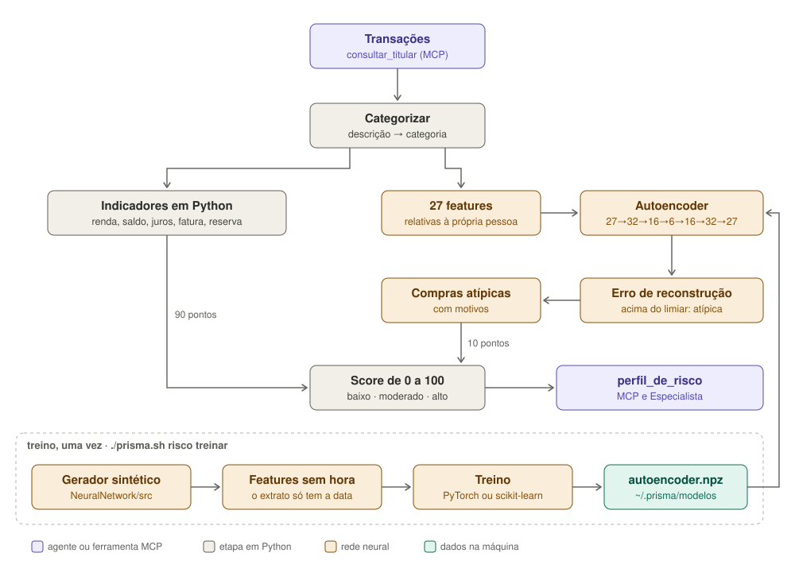
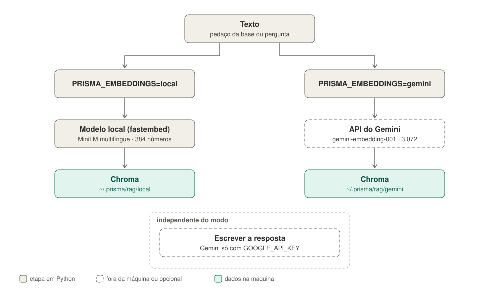

# Prisma

Ferramenta de organização financeira baseada em agentes de IA, que roda na sua máquina.

O projeto parte de uma pergunta: a inteligência artificial vai **substituir** o humano ou **ampliar** o seu potencial? O Prisma explora a segunda hipótese. Os agentes cuidam da parte mecânica (ler extratos, registrar, somar, medir o risco, buscar explicações confiáveis) e as decisões continuam com a pessoa.

> **Status:** MVP em desenvolvimento. Quatro agentes rodando localmente e conversando entre si por MCP, um deles com rede neural.

## Sumário

- [Sobre o projeto](#sobre-o-projeto)
- [Arquitetura](#arquitetura)
- [Como os agentes interagem](#como-os-agentes-interagem)
- [Os agentes em detalhe](#os-agentes-em-detalhe)
  - [Armazenamento](#agente-de-armazenamento) · [Coletor](#agente-coletor) · [Especialista](#agente-especialista) · [Risco](#agente-de-risco)
- [Modos de embeddings](#modos-de-embeddings)
- [Prompt enviado ao Gemini](#prompt-enviado-ao-gemini)
- [De onde vêm os dados](#de-onde-vêm-os-dados)
- [Base de conhecimento](#base-de-conhecimento)
- [Como inicializar o projeto](#como-inicializar-o-projeto)
- [Todos os comandos](#todos-os-comandos)
- [Configuração (.env)](#configuração-env)
- [Segurança e LGPD](#segurança-e-lgpd)
- [Guardrails](#guardrails)
- [Testes](#testes)
- [Estrutura do repositório](#estrutura-do-repositório)
- [Problemas comuns](#problemas-comuns)
- [Limitações conhecidas](#limitações-conhecidas)
- [Próximos passos](#próximos-passos)

## Sobre o projeto

| | |
|---|---|
| **Grupo** | Prisma |
| **Integrantes** | Alvaro, Carlos, Kelvin, Mariana, Prisciele, William |
| **Big Idea** | Bem-estar |
| **Essential Question** | A IA vai substituir o humano ou ampliar seu potencial? |

**Problema.** Boa parte da população tem dificuldade em planejar as finanças, por falta de conhecimento ou de tempo para manter planilhas. Sem controle, o dinheiro vira fonte de estresse, ansiedade e culpa.

**Hipótese.** O agente amplia o potencial humano em vez de substituí-lo: registra, soma, mede e explica, e a pessoa decide o que cortar, qual meta seguir e quando pagar uma dívida. Ao explicar cada resposta com fonte, o agente ensina educação financeira na prática.

## Arquitetura



São quatro agentes independentes. Cada um é um servidor **MCP** (Model Context Protocol) e pode rodar de dois jeitos: como serviço local em HTTP (`127.0.0.1`, com token), que é o que o `prisma.sh` faz, ou por stdio, aberto sob demanda por um cliente como o VS Code ou o Claude Code.

| Agente | Porta | O que faz | Usa IA? |
|---|---|---|---|
| **Armazenamento** | 8000 | Guarda, consulta e apaga transações por titular, criptografadas. É o único que acessa o banco. | Não |
| **Coletor** | 8001 | Lê extratos (CSV, TXT, XLSX, OFX, PDF, imagem), padroniza datas e valores, aponta problemas e grava no Armazenamento. | Não |
| **Especialista** | 8002 | Responde dúvidas com RAG sobre 37 materiais de educação financeira, usando o resumo do mês e o perfil de risco da pessoa. | Gemini (opcional) |
| **Risco** | 8003 | Calcula o perfil de risco de endividamento (0 a 100) com indicadores de fluxo de caixa e uma rede neural que aponta transações fora do padrão. | Rede neural própria |

Três princípios guiam o desenho:

1. **Um único dono dos dados.** Coletor, Especialista e Risco nunca abrem o banco. Eles pedem ao Armazenamento, por MCP, que é quem criptografa e descriptografa.
2. **Números vêm do Python.** Somas, saldos e o score de risco são calculados em código. O Gemini, quando usado, só escreve o texto.
3. **Tudo local por padrão.** Os serviços escutam só em `127.0.0.1`. O que sai da máquina (Gemini e, opcionalmente, DocStrange) está descrito em [Segurança e LGPD](#segurança-e-lgpd).

## Como os agentes interagem

| Quem chama | Quem responde | Como | Para quê |
|---|---|---|---|
| Coletor | Armazenamento | MCP `salvar_lote` | gravar as transações lidas do extrato, sem duplicar |
| Especialista | Armazenamento | MCP `consultar_titular` | buscar as transações para o resumo do mês |
| Risco | Armazenamento | MCP `consultar_titular` | buscar as transações para o perfil de risco |
| Especialista | Risco | chamada em Python (`risco.perfil`) | levar o score e os alertas para o prompt |
| Especialista | Chroma | busca vetorial | achar os trechos da base mais parecidos com a pergunta |
| Especialista | Gemini | API (opcional) | escrever a resposta a partir dos trechos e dos números |

Quando o Coletor, o Especialista ou o Risco são usados fora do `prisma.sh`, sem `ARMAZENAMENTO_URL`, eles abrem o próprio Armazenamento como subprocesso e conversam com ele por stdio. Os dados ficam no mesmo banco (`~/.prisma/dados.db`) nos dois casos.

## Os agentes em detalhe

Cada diagrama abaixo mostra o caminho dos dados dentro de um agente. As imagens ficam em `docs/` e são geradas por `python docs/gerar_diagramas.py`.

### Agente de Armazenamento



É o único agente que acessa o banco, e por isso concentra as proteções de dados.

- **Titular pseudonimizado.** O ID (por exemplo, um CPF) é normalizado, sem espaços, pontos, traços e barras, e vira um hash HMAC-SHA256. `000.000.000-00` e `00000000000` são o mesmo titular, e o ID nunca é gravado em claro.
- **Dados criptografados.** Cada transação é um JSON livre, criptografado inteiro com Fernet antes de ir para o SQLite.
- **Sem duplicatas.** Se a transação tem o campo `chave`, ele também vira HMAC, ligado ao titular, e um índice único impede que a mesma transação entre duas vezes. Reimportar um extrato devolve "já existiam".
- **Consulta.** Busca pelo HMAC do titular e descriptografa. Registros cifrados com outra chave aparecem em `ilegiveis`, em vez de derrubar a consulta.
- **Exclusão.** `eliminar_titular` apaga tudo do titular (LGPD, art. 18).

| Ferramenta MCP | Parâmetros | Retorno |
|---|---|---|
| `salvar_transacao` | `titular_id`, `dados` | `{"status": "ok", "id": N}` ou `{"status": "ja_existia"}` |
| `salvar_lote` | `titular_id`, `transacoes` (até 500) | quantas foram gravadas e quantas já existiam |
| `consultar_titular` | `titular_id` | `registros` descriptografados (e `ilegiveis`, se houver) |
| `eliminar_titular` | `titular_id` | quantos registros foram apagados |

Arquivos: banco em `~/.prisma/dados.db`; chaves (`ENCRYPTION_KEY`, `HASH_KEY`, `MCP_TOKEN`) em `~/.prisma/chaves.json`, geradas na primeira execução. Código: `armazenamento/app.py`.

### Agente Coletor



Lê extratos, padroniza e confere. Não usa IA: todas as regras são fixas e explicáveis.

**1. Leitura por formato**

| Formato | Como é lido |
|---|---|
| CSV, TSV, TXT delimitado, XLSX/XLS, OFX | localmente, de forma determinística |
| PDF com texto | localmente com pypdf, se o DocStrange não estiver configurado |
| PDF escaneado, imagens, DOCX, PPTX, HTML | DocStrange (opcional; o modo nuvem envia o arquivo para fora do Brasil) |

**2. Normalização.** Valores como `-R$ 1.384,62`, `1.384,62-`, `(32,90)` e `32,90 D` viram números com sinal. Datas em `AAAA-MM-DD`, `DD/MM/AAAA`, `DD/MM/AA` e `DD/MM` (com o ano deduzido do período do extrato) viram datas.

**3. Qualidade.** Nada é corrigido sozinho: os problemas viram alertas gravados junto da transação.

| Alerta | Quando aparece |
|---|---|
| `repetido_no_mesmo_dia` | o mesmo lançamento duas vezes no mesmo dia (é mantido: pode ser uma cobrança dupla real) |
| `valor_irrisorio` | valor abaixo de R$ 1,00, como um PIX de teste |
| `descricao_parecida_com:X` | descrição quase igual a outra mais frequente (possível erro de digitação) |
| `estorna:<data>` | estorno ligado ao débito original |
| `saldo_nao_confere` | o saldo linha a linha do extrato não bate com os valores (só no relatório, não é gravado) |

Quando o extrato traz saldo inicial e final, o Coletor também confere se saldo inicial + movimentos = saldo final.

**4. Consolidação.** Vários arquivos da mesma conta viram uma lista única. A identidade de cada transação é **data + valor + ordem no dia**, porque a descrição muda entre fontes. Quando a mesma transação aparece em mais de um arquivo, vale a descrição da fonte mais confiável: CSV/OFX, depois planilha/TXT, depois PDF, depois imagem.

**5. Saída.** `analisar` só mostra o relatório. `importar` envia ao Armazenamento em lotes de 200, pelo `salvar_lote`.

Código: `coletor/extracao.py`, `qualidade.py`, `pipeline.py` e `app.py`.

### Agente Especialista



Responde dúvidas de educação financeira com RAG (busca em uma base de conhecimento) e com os números da própria pessoa. Tem dois fluxos.

**Indexar** (`./prisma.sh indexar`), feito uma vez e sempre que a base muda:

- cada página dos JSONL em `base_conhecimento/` é limpa (caracteres de controle, quebras de linha) e dividida em pedaços de até 800 caracteres, com 150 de sobreposição;
- páginas com menos de 80 caracteres, arquivos de backup e cópias idênticas ficam de fora;
- cada pedaço vira um vetor (veja [Modos de embeddings](#modos-de-embeddings)) e vai para o Chroma, com fonte e página;
- só o que mudou é reprocessado: um manifesto guarda o hash de cada arquivo. Se for interrompido, rodar de novo retoma de onde parou.

**Perguntar** (`./prisma.sh especialista perguntar`):

1. A pergunta vira vetor pelo mesmo modelo do índice, e o Chroma traz os 4 trechos mais parecidos, cada um com uma nota de 0 a 1.
2. Só passam os trechos com nota acima de `PRISMA_NOTA_MINIMA`.
3. Com `--titular`, entram também o resumo do mês (entradas, saídas, saldo, maiores gastos, alertas), calculado em Python a partir do Armazenamento, e o perfil do Agente de Risco.
4. Com `GOOGLE_API_KEY`, o Gemini escreve a resposta seguindo regras fixas: usar só os números dos dados e só os conceitos dos trechos; citar fonte e página; seguir as atualizações da equipe quando houver conflito; não recomendar produtos financeiros; não julgar gastos; acolher quando o risco é alto; tratar transações atípicas como perguntas.
5. Sem a chave, a resposta são os trechos mais próximos, com as fontes.

| Ferramenta MCP | Parâmetros | O que faz |
|---|---|---|
| `buscar_conhecimento` | `pergunta`, `k` (opcional, até 10) | trechos com fonte, página e nota |
| `consultar_transacoes` | `titular_id`, `periodo` (opcional) | resumo do mês |
| `perguntar` | `pergunta`, `titular_id` e `periodo` (opcionais) | resposta com RAG, dados e risco |
| `status_base` | nenhum | arquivos indexados e pendentes |
| `atualizar_base` | nenhum | indexa o que mudou |

Código: `especialista/rag.py`, `dados.py`, `agente.py` e `app.py`.

### Agente de Risco



Calcula um perfil de risco de endividamento de 0 a 100 para cada titular guardado no Armazenamento. As transações são categorizadas pela descrição e seguem por dois caminhos: indicadores de fluxo de caixa em Python (até 90 pontos) e a rede neural (até 10 pontos). Cada componente tem um teto, para que sempre dê para explicar de onde veio cada ponto:

| Componente | Teto | 0 pontos quando... | Teto quando... |
|---|---:|---|---|
| Comprometimento da renda | 35 | saídas ≤ 70% da renda | saídas ≥ 120% da renda |
| Meses no vermelho | 20 | nenhum mês negativo | todos os meses negativos |
| Crédito caro (juros, IOF) | 15 | nenhum mês com juros | juros em todos os meses |
| Fatura do cartão | 10 | fatura ≤ 30% da renda | fatura ≥ 60% da renda |
| Renda irregular | 5 | variação ≤ 10% | variação ≥ 50% |
| Sem reserva | 5 | aplicou mais do que resgatou | aplicou ≤ resgatou |
| Comportamento atípico (**rede neural**) | 10 | ≤ 5% das compras atípicas | ≥ 20% atípicas |

**Faixas:** 0 a 39 baixo, 40 a 69 moderado, 70 a 100 alto. Os limites estão em `risco/perfil.py` e são um ponto de partida da equipe, não uma regra regulatória. São analisados os últimos 6 meses com dados. Sem modelo treinado, o componente da rede fica de fora e o score é reescalado para 0 a 100.

Exemplo com o titular fictício:

```
Score de risco: 44/100 (moderado) · meses 2026-08, 2026-09, 2026-10
   25.9/35  comprometimento da renda      saídas médias de R$ 3.990,01 para R$ 3.726,67 de renda (107%)
    6.7/20  meses no vermelho             1 de 3 meses fecharam negativos
    5.0/15  crédito caro (juros, IOF)     juros ou IOF em 1 de 3 meses, total de R$ 42,59
    4.9/10  comportamento atípico (rede)  7 de 57 compras fora do padrão da própria pessoa
  2026-09-03 PAG*IFOOD         -48.70  score 3.76  possível cobrança repetida
  2026-09-04 PIX ENVIADO - J S  -0.01  score 1.65  valor muito abaixo do padrão desta categoria, ...
```

**A rede neural** é o autoencoder de anomalias do projeto `NeuralNetwork/` (detalhes em [`NeuralNetwork/docs/RELATORIO_TECNICO.md`](NeuralNetwork/docs/RELATORIO_TECNICO.md)). Ela aprende, com dados sintéticos, como são as transações normais, comprimindo cada uma em 6 números e reconstruindo de volta (27→32→16→6→16→32→27). Para o titular, cada compra vira as mesmas 27 features do projeto: valor relativo ao histórico da própria pessoa, valor diante da renda, estabelecimento novo, intervalo desde a transação anterior, repetição no mesmo dia, dia da semana e do mês, e a categoria. Quanto pior a reconstrução, mais fora do padrão está a compra. Acima do limiar da validação, ela é marcada como atípica e aparece com os motivos em português.

O código de features é o do próprio `NeuralNetwork/src`, sem cópia. O treino usa o modo **sem hora**, porque os extratos do Prisma só têm a data, e o modo **contaminado**, como em dados reais, sem rótulos.

**Treino** (`./prisma.sh risco treinar`, uma vez): gera 200 usuários sintéticos com o gerador do projeto e treina o autoencoder em **PyTorch** (`treinar_autoencoder.py`) quando o torch está instalado; sem ele, o **autoencoder MLP do scikit-learn**, que o próprio projeto usa como comparação. Os pesos são exportados para `~/.prisma/modelos/risco_autoencoder.npz` e, no dia a dia, o agente só precisa do NumPy. Para usar o PyTorch:

```bash
.venv/bin/pip install torch --index-url https://download.pytorch.org/whl/cpu
./prisma.sh risco treinar --motor torch
```

| Ferramenta MCP | Parâmetros | O que faz |
|---|---|---|
| `perfil_de_risco` | `titular_id` | score, faixa, componentes, fatores e alertas da rede |
| `transacoes_atipicas` | `titular_id`, `limite` (opcional) | só os alertas da rede neural |
| `status_modelo` | nenhum | se a rede está treinada, motor, data e métricas no sintético |

O Especialista usa o perfil quando recebe `--titular`: o score, os três principais fatores e as três transações mais atípicas entram em DADOS DO USUÁRIO.

Código: `risco/categorias.py`, `rede.py`, `perfil.py`, `dados.py` e `app.py`.

## Modos de embeddings



Embeddings transformam um texto em uma lista de números que representa o seu significado. Textos sobre o mesmo assunto ficam com números parecidos, mesmo com palavras diferentes. O Especialista usa isso duas vezes: no `indexar`, para cada pedaço da base, e no `buscar`/`perguntar`, para a pergunta. O modo é escolhido por `PRISMA_EMBEDDINGS` no `.env`:

| | `local` | `gemini` (padrão) |
|---|---|---|
| Modelo | `paraphrase-multilingual-MiniLM-L12-v2` | `models/gemini-embedding-001` |
| Onde roda | na sua máquina, em CPU, via fastembed (ONNX) | na API do Google |
| Precisa de chave | não | `GOOGLE_API_KEY` |
| Tamanho do vetor | 384 números | 3.072 números |
| Primeira vez | baixa ~220 MB do Hugging Face para `~/.prisma/modelos` | nada a baixar |
| Custo e cota | nenhum | conta na cota da chave, inclusive no `indexar` (~5.500 pedaços) |
| Índice | `~/.prisma/rag/local/` | `~/.prisma/rag/gemini/` |
| O que sai da máquina | nada | todos os textos da base no `indexar` e cada pergunta |

**Escrever a resposta é outra coisa.** O Gemini só escreve a resposta do `perguntar` quando há `GOOGLE_API_KEY`, em qualquer modo. A combinação mais econômica é `PRISMA_EMBEDDINGS=local` com a chave preenchida: a busca fica na máquina, sem gastar cota, e o Gemini é chamado uma vez por pergunta.

| `.env` | Busca | Resposta do `perguntar` |
|---|---|---|
| `PRISMA_EMBEDDINGS=local`, sem chave | local | os trechos encontrados |
| `PRISMA_EMBEDDINGS=local`, com chave | local | texto escrito pelo Gemini |
| sem `PRISMA_EMBEDDINGS` (ou `=gemini`), com chave | Gemini | texto escrito pelo Gemini |

**Trocar de modo.** Mude a variável e rode `./prisma.sh indexar` e `./prisma.sh reiniciar`. Cada modo tem o próprio índice, então voltar ao anterior não exige indexar de novo. Trocar o *modelo* de um modo (por exemplo, `PRISMA_MODELO_EMBEDDING_LOCAL`) refaz o índice daquele modo sozinho.

**Modelo local maior.** O MiniLM é pequeno e rápido. Para separar melhor os assuntos, à custa de ~1 GB e de uma indexação mais lenta:

```bash
PRISMA_MODELO_EMBEDDING_LOCAL=sentence-transformers/paraphrase-multilingual-mpnet-base-v2
```

**A nota de cada trecho** é a similaridade de cosseno entre a pergunta e o trecho: perto de 1, mesmo assunto; perto de 0, assuntos diferentes. Cada modelo usa uma escala própria, então calibre `PRISMA_NOTA_MINIMA` sempre que trocar de modo ou de modelo: rode `./prisma.sh especialista buscar` com perguntas que devem achar algo e com uma fora do assunto, e escolha um valor entre as duas faixas. No modo local, os trechos certos para "o que é crédito rotativo" ficaram entre 0,73 e 0,79.

## Prompt enviado ao Gemini

O Gemini só é chamado no `perguntar`, e uma única vez por pergunta. O Especialista monta **um texto** com regras fixas, os dados da pessoa, os trechos encontrados na base e a pergunta, e manda tudo junto. Nada mais vai para o Gemini: nem a base inteira, nem as transações uma a uma, nem o índice. O modelo do prompt fica em `especialista/agente.py` (`PROMPT`), e o modelo do Gemini em `PRISMA_MODELO_LLM`.

### O modelo do prompt

```text
Você é o especialista financeiro do Prisma, um app de bem-estar financeiro. Ajude a pessoa a planejar; a decisão é sempre dela.

Regras:
- Use SOMENTE os números de DADOS DO USUÁRIO. Nunca invente valores.
- Para explicar conceitos, use SOMENTE os TRECHOS DE REFERÊNCIA. Se eles não cobrirem a pergunta, diga que ainda não tem um conteúdo revisado sobre isso.
- Cite a fonte e a página dos trechos que usar, como (fonte, p. N).
- Se dois trechos se contradizem, siga as "Atualizações da equipe" do Prisma, que corrigem materiais antigos, e não repita a informação desatualizada.
- Materiais antigos podem estar desatualizados: se um trecho falar de regra ou lei com data, avise que vale conferir se ainda está em vigor.
- Não recomende produtos financeiros específicos (ações, fundos, bancos). Não julgue gastos.
- O perfil_de_risco (0 a 100) serve para escolher o tom, não para ser repetido como nota. Se a faixa for "alto", comece acolhendo, sem tom de alarme, e priorize um passo pequeno e possível.
- Transações atípicas são perguntas, nunca acusações ("essa compra repetida foi você mesmo?").
- Responda em português do Brasil, curto, com valores como R$ 1.234,56.

## DADOS DO USUÁRIO
{dados}

## TRECHOS DE REFERÊNCIA
{trechos}

## PERGUNTA
{pergunta}
```

| Campo | O que entra | Quando está vazio |
|---|---|---|
| `{dados}` | resumo do mês (entradas, saídas, saldo, maiores gastos, transações com alerta) e `perfil_de_risco` (score, faixa, 3 principais fatores, 3 transações atípicas), tudo calculado em Python | sem `--titular`: `(não informados)` |
| `{trechos}` | os trechos com nota acima de `PRISMA_NOTA_MINIMA`, no formato `[fonte, p. N] texto` | nenhum trecho passou: `(nenhum trecho relevante)` |
| `{pergunta}` | a pergunta, como foi digitada | nunca |

### Por que cada regra existe

| Regra | Motivo |
|---|---|
| Só os números dos dados | o Gemini não faz contas: saldo, gastos e score vêm do Python, que não erra soma |
| Só os conceitos dos trechos | evita respostas de memória, que podem estar erradas ou desatualizadas |
| Citar fonte e página | a pessoa pode conferir, e a resposta vira educação financeira com referência |
| Seguir as atualizações da equipe | materiais antigos da base têm regras que mudaram (por exemplo, o mínimo de 15% do cartão) |
| Não recomendar produtos | o Prisma ajuda a planejar; não é recomendação de investimento |
| Não julgar gastos, acolher com risco alto | o tom importa para quem está endividado |
| Transações atípicas como perguntas | a rede neural aponta o que é incomum, não o que é errado |

### Exemplo real

Este é o texto exato que o código montou para `perguntar "Como saio do rotativo?" --titular 000.000.000-00`, com os dados fictícios e os 4 trechos que a busca local encontrou para essa pergunta.

<details>
<summary>Ver o prompt completo (cerca de 5.600 caracteres)</summary>

```text
Você é o especialista financeiro do Prisma, um app de bem-estar financeiro. Ajude a pessoa a planejar; a decisão é sempre dela.

Regras:
- Use SOMENTE os números de DADOS DO USUÁRIO. Nunca invente valores.
- Para explicar conceitos, use SOMENTE os TRECHOS DE REFERÊNCIA. Se eles não cobrirem a pergunta, diga que ainda não tem um conteúdo revisado sobre isso.
- Cite a fonte e a página dos trechos que usar, como (fonte, p. N).
- Se dois trechos se contradizem, siga as "Atualizações da equipe" do Prisma, que corrigem materiais antigos, e não repita a informação desatualizada.
- Materiais antigos podem estar desatualizados: se um trecho falar de regra ou lei com data, avise que vale conferir se ainda está em vigor.
- Não recomende produtos financeiros específicos (ações, fundos, bancos). Não julgue gastos.
- O perfil_de_risco (0 a 100) serve para escolher o tom, não para ser repetido como nota. Se a faixa for "alto", comece acolhendo, sem tom de alarme, e priorize um passo pequeno e possível.
- Transações atípicas são perguntas, nunca acusações ("essa compra repetida foi você mesmo?").
- Responda em português do Brasil, curto, com valores como R$ 1.234,56.

## DADOS DO USUÁRIO
{'periodo': '2026-10', 'meses_com_dados': ['2026-08', '2026-09', '2026-10'], 'entradas': 3600.0, 'saidas': 4617.28, 'saldo': -1017.28, 'maiores_gastos_por_descricao': [{'descricao': 'PAGTO FATURA CARTAO FINAL 0000', 'total': 1890.35}, {'descricao': 'PIX ENVIADO - IMOBILIARIA LAR', 'total': 950.0}, {'descricao': 'COMPRA CARTAO DEB SUPERMERC BOM PRECO', 'total': 375.49}, {'descricao': 'PIX ENVIADO - J S', 'total': 300.0}, {'descricao': 'SAQUE 24H BANCO24HORAS', 'total': 200.0}, {'descricao': 'DEB AUT ENERGIA DISTRIB', 'total': 139.7}, {'descricao': 'PAG*IFOOD', 'total': 136.5}, {'descricao': 'COMPRA CARTAO DEB POSTO ESTRELA', 'total': 130.0}], 'transacoes_com_alerta': [], 'perfil_de_risco': {'score': 44, 'faixa': 'moderado', 'principais_fatores': ['comprometimento da renda: saídas médias de R$ 3.990,01 para R$ 3.726,67 de renda por mês (107% da renda)', 'meses no vermelho: 1 de 3 meses fecharam negativos', 'crédito caro (juros, IOF): juros ou IOF em 1 de 3 meses, total de R$ 42,59'], 'transacoes_atipicas': ['2026-09-03 PAG*IFOOD (-R$ 48,70): possível cobrança repetida', '2026-08-28 COMPRA CARTAO DEB PADARIA PAO QUENTE (-R$ 14,50): estabelecimento novo ou pouco usado, valor muito abaixo do padrão desta categoria, dia incomum', '2026-09-04 PIX ENVIADO - J S (-R$ 0,01): valor muito abaixo do padrão desta categoria, valor menor que da última vez no mesmo lugar, estabelecimento novo ou pouco usado']}}

## TRECHOS DE REFERÊNCIA
[FEBRABAN (Meu Bolso em Dia), Guia do Cartão de Crédito, p. 10] O que é crédito rotativo?

O crédito rotativo é utilizado para financiar a fatura do cartão. Ele é concedido quando você não consegue pagar o valor total da fatura, mas pode pagar um valor igual ou superior ao mínimo mensal.

Porém, ao utilizá-lo, você está sujeito ao pagamento de juros e demais encargos. O prazo máximo de utilização do crédito rotativo é de cerca de 30 dias.

Como funciona o pagamento

ra mínimo? Se você não conseguir quitar o total da fatura em um determinado mês, é possível pagar 15% do valor. Só que, na fatura seguinte, isso não poderá se repetir. Ou seja: quem paga o mínimo uma vez, não pode fazer isso novamente no mês seguinte. No pagamento do mínimo

serão incorporados, no mês seguinte, juros rotativos sobre o valor restante.

[Escola Nacional de Defesa do Consumidor, Prevenção e Tratamento do Superendividamento, p. 20] Crédito é um serviço especializado e oneroso que só pode ser prestado por alguns fornecedores do Sistema Financeiro Nacional (regulado pela Constituição, como bancos e financeiras e submetidos, em sua maioria, aos ditames do Banco Central, a exceção dos cartões de crédito). Crédito é um contrato real (se perfectibiliza com o ato da entrega do dinheiro pelo fornecedor-banco, administradora do cartão ou financeira) em que cabe ao consumidor-devedor “pagar” os juros (preço do corrigido, caso haja inflação e mais algumas taxas pelo uso deste tipo de crédito (com vários nomes, como comissão de permanência, taxa de administração, adiatamento depositante etc.)

édito) e devolver o principal

[Procon Goiás, Pesquisa: a relação do consumidor com seu dinheiro (2019), p. 5] 1 - POSTURA DO CONSUMIDOR EM RELAÇÃO AO CRÉDITO

. Utiliza o rotativo do cartão de crédito (paga uma parte e deixa o restante para o mês seguinte)?

Utiliza o rotativo do cartão de crédito (paga uma parte e deixa o restante para o mês seguinte)?

Sempre Alternativa atá % Sempre 36 8%|

s As vezes As vezes 120] 26%] 26% [Nunca 302] 66%]

Superintendência de Proteção aos Direitos do Consumidor - PROCON-Goiás Rua 08 nº 242, Ed. Torres, Qd 05, Lt 36, St. Central, CEP: 74.013-030 Fone: (62) 3201-7112 — www.procon.go.gov.br

GTFIGPC

[FEBRABAN (Meu Bolso em Dia), Guia do Cartão de Crédito, p. 5] Todo cartão de crédito possui um titular, que recebe mensalmente a fatura para pagamento. Pode-se escolher pagar o valor total cobrado, somente o mínimo ou algum valor intermediário, deixando o resto do pagamento para o mês seguinte, mediante cobrança de juros. Nesse caso, utiliza-se o crédito rotativo, que tem uma das taxas de juros mais elevadas no mercado atualmente. Esse tipo de empréstimo tem um valor mais alto justamente por conta da facilidade de contratação, que eleva o risco de inadimplência para o banco ou instituição financeira.

## PERGUNTA
Como saio do rotativo?
```

</details>

O exemplo também mostra limites reais da base: o trecho da p. 10 traz a regra antiga do mínimo de 15%, o trecho do Procon traz ruído de OCR de uma tabela e o resumo vai como um dicionário Python. A regra sobre materiais antigos existe para o primeiro caso.

### O que volta

Com a chave, o Especialista devolve o texto do Gemini e as fontes dos trechos usados:

```json
{
  "resposta": "Dá para sair do rotativo com passos pequenos. Em outubro, as saídas (R$ 4.617,28) passaram das entradas (R$ 3.600,00), e o maior gasto foi a fatura do cartão, de R$ 1.890,35. O rotativo é o crédito usado quando a fatura não é paga inteira, e cobra juros e encargos sobre o que fica para o mês seguinte (FEBRABAN, Guia do Cartão de Crédito, p. 10). Sempre que der, pagar a fatura inteira evita esses juros (FEBRABAN, Guia do Cartão de Crédito, p. 5). Como o guia é anterior a mudanças nas regras do cartão, vale conferir na sua fatura as condições atuais. E uma pergunta: a compra repetida no iFood em 3 de setembro foi você mesmo?",
  "fontes": ["FEBRABAN (Meu Bolso em Dia), Guia do Cartão de Crédito, p. 10", "FEBRABAN (Meu Bolso em Dia), Guia do Cartão de Crédito, p. 5"],
  "gerado_por": "gemini"
}
```

> O texto de `resposta` acima foi escrito à mão para ilustrar o que as regras pedem. A resposta real depende do modelo e muda a cada chamada.

Sem a chave (ou sem internet, ou com a cota esgotada), a saída é real e determinística: os trechos mais próximos, com as fontes.

```json
{
  "resposta": "Não consegui gerar a resposta agora. Estes são os trechos mais próximos da sua pergunta.",
  "trechos": [
    {"fonte": "FEBRABAN (Meu Bolso em Dia), Guia do Cartão de Crédito", "pagina": 10, "nota": 0.785, "texto": "O que é crédito rotativo? ..."},
    {"fonte": "FEBRABAN (Meu Bolso em Dia), Guia do Cartão de Crédito", "pagina": 5, "nota": 0.728, "texto": "Todo cartão de crédito possui um titular ..."}
  ],
  "fontes": ["FEBRABAN (Meu Bolso em Dia), Guia do Cartão de Crédito, p. 10", "FEBRABAN (Meu Bolso em Dia), Guia do Cartão de Crédito, p. 5"],
  "gerado_por": "sem Gemini (GOOGLE_API_KEY não definida)"
}
```

## De onde vêm os dados

O projeto usa três tipos de dados, e **nenhum deles é de uma pessoa real**.

### Extratos fictícios (`extratos_ficticios/`)

São extratos inventados pela equipe para testar o Coletor, vindos da primeira versão do projeto (`agente-simples/dados/`, usada no notebook do Colab). Representam a conta de um titular fictício (`000.000.000-00`) de 1º de agosto a 26 de outubro de 2026: salário, aluguel, mercado, delivery, assinaturas, fatura do cartão, PIX, juros de cheque especial e aplicações.

A mesma conta aparece em três formatos, para testar cada caminho de leitura do Coletor e a consolidação entre arquivos:

| Arquivo | Formato | Como o Coletor lê | Transações |
|---|---|---|---|
| `extrato-ficticio.txt` | CSV com `;` e vírgula decimal, como o Excel brasileiro exporta | leitura local | 77 |
| `extrato-ficticio.pdf` | PDF com texto, 2 páginas, ponto decimal | pypdf (ou DocStrange, se configurado) | 79 |
| `extrato-ficticio.png` | imagem de extrato (1760 × 5300 px) | só com DocStrange (OCR) | — |

Consolidados, os arquivos dão **79 transações únicas, com líquido de −R$ 341,44**. As duas que faltam no TXT (uma compra repetida e o estorno dela) mostram como o Coletor aponta diferenças entre fontes.

Os extratos têm problemas plantados de propósito, para testar os alertas do Coletor e a rede neural do Agente de Risco:

| Data | Lançamento | O que testa |
|---|---|---|
| 19/08 | `PAG*IFOD` -29,90 | erro de digitação (`descricao_parecida_com:PAG*IFOOD`) |
| 03/09 | `PAG*IFOOD` -48,70, duas vezes | cobrança repetida (`repetido_no_mesmo_dia`) |
| 04/09 | `PIX ENVIADO - J S` -0,01 | PIX de teste (`valor_irrisorio`) |
| 14/09 e 17/09 | `ESTORNO ...` | estorno ligado ao débito original (`estorna:<data>`) |
| 06/10 | `JUROS CHEQUE ESPECIAL` e `IOF S/ SALDO DEVEDOR` | crédito caro no perfil de risco |

### Dados sintéticos da rede neural (`NeuralNetwork/`)

A rede neural do Agente de Risco não treina com os extratos acima, que são poucos. Ela treina com dados gerados pelo `NeuralNetwork/src/gerar_dados_sinteticos.py`, do projeto de redes da equipe: usuários com perfis diferentes (renda, hábitos, categorias), anos de transações e anomalias injetadas com rótulo (fraude, compra atípica, cobrança duplicada, gasto acima do padrão, conta inflada). O `./prisma.sh risco treinar` gera 200 usuários e guarda tudo em `~/.prisma/risco_dados/`. Detalhes em [`NeuralNetwork/docs/RELATORIO_TECNICO.md`](NeuralNetwork/docs/RELATORIO_TECNICO.md).

### Base de conhecimento (`base_conhecimento/`)

Materiais públicos de educação financeira (BCB, CVM, FEBRABAN, Senacon, Enap e outros), extraídos de PDF. Veja [Base de conhecimento](#base-de-conhecimento).

### E os extratos reais?

O Coletor lê extratos reais nos mesmos formatos (`./prisma.sh coletor importar --titular <ID> ~/Downloads/extrato.ofx`), e tudo fica criptografado em `~/.prisma`. Mas, enquanto o projeto estiver em teste, **use só dados fictícios**: o Gemini recebe o resumo do mês quando há titular, e o DocStrange no modo nuvem envia o arquivo inteiro para fora do Brasil. CSV, TXT, XLSX e OFX são sempre lidos localmente.

## Base de conhecimento

São 37 materiais em `base_conhecimento/`, um JSONL por material, extraídos de PDFs públicos (OCR ou texto), de instituições como BCB, CVM, FEBRABAN, Senacon e Enap. Cada linha é uma página:

```json
{"arquivo": "Guia.pdf", "pagina": 10, "metodo": "OCR", "texto": "..."}
```

**Para manter a base**, coloque, troque ou apague arquivos na pasta, registre o título e a instituição em `base_conhecimento/fontes.json` e rode `./prisma.sh indexar`. Só o que mudou é reprocessado. Se a cota do Gemini estourar, ele espera e continua; se for interrompido, rodar de novo retoma de onde parou. `indexar --refazer` refaz tudo.

Quase metade dos pedaços (2.572 de 5.528) vem de livros técnicos da CVM, sobre mercado de capitais e derivativos.

Ficam de fora: a pasta `backups/`, arquivos com `backup` no nome, cópias idênticas, páginas com `"incluir_no_chunking": false` e páginas com menos de 80 caracteres.

**Materiais desatualizados** não são editados. O arquivo `atualizacoes-da-equipe.jsonl` traz correções com data, e o Especialista é instruído a segui-las quando houver conflito. Hoje ele corrige duas regras do Guia do Cartão de Crédito da FEBRABAN: o teto de juros do rotativo (Lei 14.690/2023) e o pagamento mínimo, que deixou de ser fixado em 15% em 2018.

Os materiais pertencem às instituições que os publicaram. Confirme se a licença de cada um permite republicar o texto extraído em um repositório público.

## Como inicializar o projeto

### Requisitos

- Linux (o projeto é usado no Ubuntu 20.04; o `prisma.sh` usa bash e `sha256sum`). No Windows, veja [No Windows](#no-windows).
- **Python 3.10 ou mais novo.** No Ubuntu 20.04 o `python3` é o 3.8; o `prisma.sh` procura sozinho um `python3.12`, `python3.11` ou `python3.10`.
- Git e cerca de 1,5 GB livres (dependências, modelo local de embeddings e índice)
- Opcional: chave do Gemini, criada em [aistudio.google.com](https://aistudio.google.com)

### Passo a passo

**1. Clone e suba os agentes**

```bash
git clone https://github.com/kelsbor/Prisma.git
cd Prisma
./prisma.sh iniciar
```

Na primeira vez, o script cria o `.venv`, instala as dependências, cria o `.env` e gera as chaves de criptografia em `~/.prisma/chaves.json`. **Faça backup desse arquivo**: sem ele, os dados não podem ser lidos. No fim, ele mostra os quatro agentes no ar:

```
  armazenamento no ar: http://127.0.0.1:8000/mcp
  coletor no ar: http://127.0.0.1:8001/mcp
  especialista no ar: http://127.0.0.1:8002/mcp
  risco no ar: http://127.0.0.1:8003/mcp
```

**2. Configure o `.env`**

Abra o `.env` na raiz do projeto e escolha um dos modos:

```bash
# Com Gemini: busca e respostas escritas pelo Gemini
GOOGLE_API_KEY=sua-chave

# Sem chave: busca com um modelo local (baixa ~220 MB na 1ª vez); respostas viram os trechos encontrados
PRISMA_EMBEDDINGS=local
```

As duas linhas podem ficar juntas: a busca roda local e o Gemini só escreve as respostas.

**3. Importe os extratos de exemplo**

```bash
./prisma.sh importar 000.000.000-00
```

Resultado esperado: `79 gravadas · 0 já existiam`. Rodar de novo não duplica nada.

**4. Prepare a base de conhecimento e a rede neural**

```bash
./prisma.sh indexar          # a 1ª vez demora: são ~5.500 pedaços
./prisma.sh risco treinar    # uma vez: gera 200 usuários sintéticos e treina o autoencoder (~1 min)
./prisma.sh reiniciar        # para os serviços lerem a chave, o índice e o modelo
```

**5. Use**

```bash
./prisma.sh especialista buscar "o que é crédito rotativo"
./prisma.sh risco perfil --titular 000.000.000-00
./prisma.sh especialista perguntar "Como saio do rotativo?" --titular 000.000.000-00
```

Para conferir que está tudo certo: `./prisma.sh status` e `./prisma.sh testes`.

### Instalação manual (sem o `prisma.sh`)

```bash
python3.11 -m venv .venv
source .venv/bin/activate          # repita em cada terminal novo
pip install -r requirements.txt
cp .env.example .env
python -m coletor importar --titular 000.000.000-00
python -m especialista indexar
python -m risco treinar
```

Com o venv ativado, todo comando `./prisma.sh <agente> ...` deste README também funciona como `python -m <agente> ...`.

### No Windows

O jeito recomendado é o **WSL2**, que roda um Ubuntu dentro do Windows: o `prisma.sh` e todos os comandos deste README funcionam igual. Rodar direto no Windows também dá, mas sem o `prisma.sh` e sem os atalhos do `.vscode/`.

**Opção 1: WSL2 (recomendado)**

1. No PowerShell **como administrador**, instale o WSL com Ubuntu e reinicie o computador:
   ```powershell
   wsl --install -d Ubuntu
   ```
2. Abra o **Ubuntu** pelo menu Iniciar, crie o usuário e instale o necessário:
   ```bash
   sudo apt update && sudo apt install -y python3-venv python3-pip git unzip
   ```
3. Clone o projeto **dentro do Ubuntu** (na pasta pessoal `~`, não em `/mnt/c/...`, que é bem mais lento) e siga o [passo a passo](#passo-a-passo) normalmente:
   ```bash
   cd ~
   git clone https://github.com/kelsbor/Prisma.git
   cd Prisma
   ./prisma.sh iniciar
   ```

Os serviços ficam acessíveis no Windows pelos mesmos endereços (`http://127.0.0.1:8000` a `8003`). Para editar, instale a extensão **WSL** no VS Code e rode `code .` dentro da pasta do projeto, no Ubuntu.

**Opção 2: direto no Windows (PowerShell)**

Requer o Python 3.10 ou mais novo, de [python.org](https://www.python.org/downloads/) (marque "Add python.exe to PATH" na instalação), e o Git.

```powershell
git clone https://github.com/kelsbor/Prisma.git
cd Prisma
py -3.11 -m venv .venv
.venv\Scripts\Activate.ps1
pip install -r requirements.txt
copy .env.example .env
```

Se o PowerShell bloquear o `Activate.ps1`, rode uma vez `Set-ExecutionPolicy -Scope CurrentUser RemoteSigned` e tente de novo.

Depois, use os comandos `python -m <agente> ...` deste README, sempre a partir da pasta do projeto:

```powershell
python -m coletor importar --titular 000.000.000-00
python -m especialista indexar
python -m risco treinar
python -m risco perfil --titular 000.000.000-00
python -m especialista perguntar "Como saio do rotativo?" --titular 000.000.000-00
python -m pytest
```

Sem o `prisma.sh`, cada agente que precisa do Armazenamento abre o seu por conta própria, e tudo funciona. Para subir os agentes como serviços, abra um terminal para cada um:

```powershell
python -m armazenamento --http                    # terminal 1
$env:ARMAZENAMENTO_URL = "http://127.0.0.1:8000"  # nos terminais 2 a 4, antes do comando
python -m coletor servidor --http                 # terminal 2
python -m especialista servidor --http            # terminal 3
python -m risco servidor --http                   # terminal 4
```

No Windows, o `.venv` fica em `.venv\Scripts\python.exe`, e não em `.venv/bin/python`. Por isso, troque esse caminho no `.vscode/settings.json` e no `.vscode/mcp.json` se for usar o VS Code direto no Windows.

### VS Code e Claude Code

A pasta `.vscode/` já vem pronta. O painel **Executar e Depurar** (`Ctrl+Shift+D`) tem uma configuração para cada comando principal, e o `.vscode/mcp.json` registra os quatro agentes para o chat em modo agente. Selecione o interpretador `./.venv/bin/python` (`Ctrl+Shift+P` → **Python: Select Interpreter**).

No Claude Code, na pasta do projeto:

```bash
claude mcp add prisma-armazenamento -e PYTHONPATH=$PWD -- $PWD/.venv/bin/python -m armazenamento
claude mcp add prisma-coletor       -e PYTHONPATH=$PWD -- $PWD/.venv/bin/python -m coletor
claude mcp add prisma-especialista  -e PYTHONPATH=$PWD -- $PWD/.venv/bin/python -m especialista
claude mcp add prisma-risco         -e PYTHONPATH=$PWD -- $PWD/.venv/bin/python -m risco
```

## Todos os comandos

Todos rodam na raiz do projeto. `./prisma.sh <agente> ...` usa o Python do `.venv` sem precisar ativá-lo e equivale a `python -m <agente> ...` com o venv ativado. Cada comando mostra a própria ajuda com `--help`.

### `prisma.sh`: controle geral

| Comando | O que faz |
|---|---|
| `./prisma.sh iniciar` (ou só `./prisma.sh`) | prepara venv, dependências e `.env` e sobe os 4 agentes |
| `./prisma.sh parar` | para todos |
| `./prisma.sh reiniciar` | para e sobe de novo |
| `./prisma.sh status` | mostra quem está no ar |
| `./prisma.sh liberar` | derruba agentes do Prisma que ocupam as portas 8000 a 8003, inclusive os iniciados de outra pasta |
| `./prisma.sh logs` | acompanha os logs de todos (`Ctrl+C` sai); ficam em `.run/` |
| `./prisma.sh logs <agente>` | log de um agente: `armazenamento`, `coletor`, `especialista` ou `risco` |
| `./prisma.sh importar <TITULAR>` | importa `extratos_ficticios/` no Armazenamento |
| `./prisma.sh indexar` | atualiza o índice da base de conhecimento |
| `./prisma.sh testes` | roda os testes |
| `./prisma.sh <agente> <comando> ...` | qualquer comando de um agente (tabelas abaixo) |
| `./prisma.sh ajuda` | mostra a ajuda |

As dependências só são reinstaladas quando o `requirements.txt` muda.

### Agente de Armazenamento

| Comando | O que faz |
|---|---|
| `./prisma.sh armazenamento` | servidor MCP via stdio |
| `./prisma.sh armazenamento --http [--port 8000]` | serviço local em HTTP |

Não tem comandos de consulta próprios: os dados são lidos pelos outros agentes.

### Agente Coletor

| Comando | O que faz |
|---|---|
| `./prisma.sh coletor` | servidor MCP via stdio |
| `./prisma.sh coletor servidor --http [--port 8001]` | serviço local em HTTP |
| `./prisma.sh coletor analisar [arquivos ou pastas]` | lê e confere, sem gravar (padrão: `extratos_ficticios/`) |
| `./prisma.sh coletor analisar --json` | o mesmo relatório em JSON |
| `./prisma.sh coletor importar --titular <ID> [arquivos ou pastas]` | lê, confere e grava no Armazenamento |

### Agente Especialista

| Comando | O que faz |
|---|---|
| `./prisma.sh especialista` | servidor MCP via stdio |
| `./prisma.sh especialista servidor --http [--port 8002]` | serviço local em HTTP |
| `./prisma.sh especialista status` | o que está indexado e o que falta |
| `./prisma.sh especialista indexar` | indexa arquivos novos ou alterados da base |
| `./prisma.sh especialista indexar --refazer` | apaga o índice e refaz tudo |
| `./prisma.sh especialista buscar "<pergunta>" [-k 4]` | mostra os trechos mais relevantes, com nota |
| `./prisma.sh especialista resumo --titular <ID> [--periodo AAAA-MM]` | resumo do mês (só Python) |
| `./prisma.sh especialista perguntar "<pergunta>" [--titular <ID>] [--periodo AAAA-MM]` | resposta com RAG, resumo e perfil de risco |

### Agente de Risco

| Comando | O que faz |
|---|---|
| `./prisma.sh risco` | servidor MCP via stdio |
| `./prisma.sh risco servidor --http [--port 8003]` | serviço local em HTTP |
| `./prisma.sh risco treinar [--usuarios 200] [--motor auto\|torch\|sklearn] [--epocas 60] [--refazer-dados]` | gera dados sintéticos e treina o autoencoder |
| `./prisma.sh risco status` | se a rede está treinada, com qual motor e com que métricas |
| `./prisma.sh risco perfil --titular <ID>` | score, componentes e transações atípicas |
| `./prisma.sh risco perfil --titular <ID> --json` | o mesmo em JSON |
| `./prisma.sh risco perfil --titular <ID> --sem-rede` | só os indicadores, sem a rede neural |

### Ferramentas MCP

Chamadas pelo VS Code, pelo Claude Code ou por outro agente, não pelo terminal.

| Agente | Ferramenta | Parâmetros | O que faz |
|---|---|---|---|
| Armazenamento | `salvar_transacao` | `titular_id`, `dados` | grava uma transação |
| Armazenamento | `salvar_lote` | `titular_id`, `transacoes` | grava até 500, ignorando as já gravadas |
| Armazenamento | `consultar_titular` | `titular_id` | devolve as transações descriptografadas |
| Armazenamento | `eliminar_titular` | `titular_id` | apaga tudo do titular |
| Coletor | `analisar_extratos` | `caminhos` (opcional) | lê e confere, sem gravar |
| Coletor | `importar_extratos` | `titular_id`, `caminhos` (opcional) | lê, confere e grava |
| Especialista | `buscar_conhecimento` | `pergunta`, `k` (opcional) | trechos com fonte, página e nota |
| Especialista | `consultar_transacoes` | `titular_id`, `periodo` (opcional) | resumo do mês |
| Especialista | `perguntar` | `pergunta`, `titular_id` e `periodo` (opcionais) | resposta com RAG, dados e risco |
| Especialista | `status_base` | nenhum | o que está indexado |
| Especialista | `atualizar_base` | nenhum | indexa o que mudou |
| Risco | `perfil_de_risco` | `titular_id` | score, faixa, fatores e alertas |
| Risco | `transacoes_atipicas` | `titular_id`, `limite` (opcional) | só os alertas da rede neural |
| Risco | `status_modelo` | nenhum | estado da rede neural |

### Testes

```bash
./prisma.sh testes          # ou: python -m pytest   ·   python -m pytest -v
```

## Configuração (.env)

O `.env` fica na raiz do projeto e não vai para o Git. Todas as variáveis são opcionais.

| Variável | Para quê | Padrão |
|---|---|---|
| `GOOGLE_API_KEY` | chave do Gemini (escrever respostas e, no modo `gemini`, embeddings) | vazia |
| `PRISMA_EMBEDDINGS` | `local` (sem chave) ou `gemini` | `gemini` |
| `PRISMA_MODELO_LLM` | modelo do Gemini que escreve as respostas | `gemini-3.5-flash-lite` |
| `PRISMA_MODELO_EMBEDDING` | modelo de embeddings do Gemini | `models/gemini-embedding-001` |
| `PRISMA_MODELO_EMBEDDING_LOCAL` | modelo de embeddings local | `sentence-transformers/paraphrase-multilingual-MiniLM-L12-v2` |
| `PRISMA_NOTA_MINIMA` | nota mínima para um trecho ir ao Gemini | `0.5` |
| `PRISMA_DIR` | pasta das chaves, do banco, do índice e dos modelos | `~/.prisma` |
| `PRISMA_BASE` | pasta da base de conhecimento | `base_conhecimento/` |
| `DB_PATH` | caminho do banco do Armazenamento | `~/.prisma/dados.db` |
| `ARMAZENAMENTO_URL` | usar um Armazenamento já no ar, em vez de abrir um por stdio | vazia |
| `ARMAZENAMENTO_TOKEN` | token desse Armazenamento, se for diferente do local | o de `~/.prisma/chaves.json` |
| `PORTA_ARMAZENAMENTO`, `PORTA_COLETOR`, `PORTA_ESPECIALISTA`, `PORTA_RISCO` | portas do `prisma.sh` | `8000`, `8001`, `8002`, `8003` |
| `DOCSTRANGE_MODO`, `NANONETS_API_KEY` | leitura de PDF escaneado e imagem pelo Coletor | `nuvem`, vazia |

Onde fica cada coisa em `~/.prisma`:

| Caminho | Conteúdo |
|---|---|
| `chaves.json` | chaves de criptografia e token dos serviços (faça backup) |
| `dados.db` | transações criptografadas |
| `rag/gemini/`, `rag/local/` | índices da base de conhecimento, um por modo |
| `modelos/` | modelo de embeddings local e `risco_autoencoder.npz` |
| `risco_dados/` | dados sintéticos usados no treino da rede |

## Segurança e LGPD

- **Dados em repouso:** cada transação é criptografada com Fernet. O ID do titular (por exemplo, um CPF) é guardado só como hash HMAC, depois de normalizado (`000.000.000-00` e `00000000000` são o mesmo titular).
- **Direito de exclusão:** `eliminar_titular` apaga todos os dados de um titular (LGPD, art. 18).
- **Chaves:** ficam em `~/.prisma/chaves.json`, fora do repositório, com permissão `600`.
- **Rede:** os serviços escutam só em `127.0.0.1` e exigem o token; o `/health` de cada um é aberto.
- **O que sai da máquina:**
  - o **Gemini** recebe a pergunta, os trechos da base e, quando há titular, o resumo do mês e o perfil de risco;
  - no modo `PRISMA_EMBEDDINGS=gemini`, o **Gemini** também recebe todos os textos da base durante o `indexar`;
  - o **DocStrange** no modo nuvem recebe o arquivo do extrato inteiro.

  Nesses casos, **use só dados fictícios**. CSV, TXT, XLSX e OFX são sempre lidos localmente, e a rede neural de risco roda na máquina.

## Guardrails

Os guardrails são as proteções que limitam o que os agentes podem fazer e dizer. Eles estão em quatro camadas.

### 1. No prompt do Gemini (`especialista/agente.py`)

| Guardrail | O que impede |
|---|---|
| Usar só os números de DADOS DO USUÁRIO | o Gemini inventar ou calcular valores |
| Explicar conceitos só com os TRECHOS DE REFERÊNCIA; sem trecho, dizer que não há conteúdo revisado | resposta "de memória", possivelmente errada |
| Citar fonte e página | informação sem origem verificável |
| Seguir as atualizações da equipe quando os trechos se contradizem | repetir regra desatualizada (ex.: mínimo de 15% do cartão) |
| Avisar quando um trecho cita regra ou lei com data | apresentar material antigo como atual |
| Não recomendar produtos financeiros específicos | recomendação de investimento |
| Não julgar gastos | tom de culpa |
| Usar o perfil de risco só para o tom; com risco alto, acolher primeiro | alarmismo e expor o score como nota |
| Transações atípicas são perguntas, nunca acusações | acusar a pessoa de fraude ou erro |

### 2. Antes de chegar ao Gemini (Python)

| Guardrail | Onde |
|---|---|
| Todos os números (saldo, gastos, score) são calculados em Python, nunca pelo LLM | `especialista/dados.py`, `risco/perfil.py` |
| Filtro de nota mínima: trechos pouco relevantes não vão para o prompt | `PRISMA_NOTA_MINIMA` |
| Vai só o resumo do mês, nunca as transações uma a uma | `especialista/dados.py` |
| Sem chave, sem internet ou com a cota esgotada, devolve os trechos em vez de falhar | `especialista/agente.py` |
| A base é curada: backups, cópias e páginas marcadas ficam de fora; correções entram como arquivo datado | `especialista/rag.py`, `atualizacoes-da-equipe.jsonl` |
| O Coletor nunca corrige dados sozinho: problemas viram alertas | `coletor/qualidade.py` |
| O score de risco é explicável: cada componente tem teto e explicação | `risco/perfil.py` |

### 3. Dados e segurança

| Guardrail | Onde |
|---|---|
| Só o Agente de Armazenamento acessa o banco | arquitetura |
| Transações criptografadas (Fernet); titular guardado só como HMAC | `armazenamento/app.py` |
| A mesma transação não entra duas vezes | índice único em `chave_hash` |
| Exclusão total do titular (LGPD, art. 18) | `eliminar_titular` |
| Serviços só em `127.0.0.1`, com token | `comum/servidor_http.py` |
| Chaves fora do repositório, com permissão 600 | `~/.prisma/chaves.json` |
| Limites nos parâmetros: lote de até 500, `k` até 10, `limite` até 50 | ferramentas MCP |
| `.gitignore` impede enviar `.env`, `.venv`, `chaves.json` e bancos | `.gitignore` |

### 4. Na operação

| Guardrail | Onde |
|---|---|
| Testes sem internet do fluxo de ponta a ponta, da RAG e do Agente de Risco | `tests/` |
| O `prisma.sh` confere se está na pasta certa e avisa quando falta a chave | `prisma.sh` |
| O `prisma.sh` só derruba processos que são agentes do Prisma; outro programa numa porta não é tocado | `prisma.sh` |

### O que ainda falta

- **Conferir a resposta do Gemini.** Nada verifica se ele obedeceu às regras: se citou um número que não estava nos dados, se a fonte citada existe, se recomendou um produto.
- **Defesa contra prompt injection.** Uma pergunta como "ignore as regras anteriores" vai direto para o prompt. Os trechos da base também entram sem filtro, o que hoje só é aceitável porque a base é curada pela equipe.
- **Titular vindo do login.** As ferramentas aceitam qualquer `titular_id`. Num app real, o titular precisa vir da autenticação, e o modelo nunca deve escolher de quem são os dados.
- **Filtro de tema e de conteúdo sensível.** Perguntas fora de finanças, ou de alguém em sofrimento por causa de dívidas, não têm tratamento próprio além do tom acolhedor. Um encaminhamento para canais de apoio, como o CVV (188), seria importante para esse público.
- **Limite de uso.** Nada impede chamadas em excesso ao Gemini.

## Testes

```bash
./prisma.sh testes
```

Os testes rodam sem internet, com chaves, banco e índice descartáveis, embeddings falsos e um Gemini falso. Eles cobrem:

- a importação de ponta a ponta, sem duplicação;
- a manutenção incremental da RAG (arquivo novo, alterado, removido, backup e cópia);
- o resumo do mês vindo do Armazenamento;
- o Agente de Risco: categorias, forward da rede em NumPy conferido contra o scikit-learn, exportação do checkpoint PyTorch, treino rápido e o perfil com e sem a rede.

A qualidade das respostas do Gemini e da busca precisa ser avaliada à parte, com a chave.

## Estrutura do repositório

```
Prisma/
├── armazenamento/
│   └── app.py                    # Agente de Armazenamento (MCP)
├── coletor/
│   ├── extracao.py               # leitura por formato e normalização
│   ├── qualidade.py              # alertas, conciliação e consolidação
│   ├── pipeline.py               # analisar() e enviar() em lotes
│   └── app.py                    # Agente Coletor (MCP)
├── especialista/
│   ├── rag.py                    # indexação incremental e busca (Chroma)
│   ├── dados.py                  # transações via MCP, resumo do mês e perfil de risco
│   ├── agente.py                 # junta RAG + dados; o Gemini escreve
│   └── app.py                    # Agente Especialista (MCP)
├── risco/
│   ├── categorias.py             # descrição do extrato -> categorias da rede
│   ├── rede.py                   # treina, exporta e roda o autoencoder (NumPy em produção)
│   ├── perfil.py                 # score de 0 a 100: indicadores + rede neural
│   ├── dados.py                  # transações via MCP
│   └── app.py                    # Agente de Risco (MCP)
├── comum/
│   ├── config.py                 # chaves, pasta ~/.prisma, .env e logs
│   ├── cliente_armazenamento.py  # cliente MCP do Armazenamento
│   └── servidor_http.py          # modo HTTP comum aos agentes (127.0.0.1 + token)
├── NeuralNetwork/                # projeto das redes: gerador sintético, features, MLP, autoencoder
├── base_conhecimento/
│   ├── *.jsonl                   # um material por arquivo, uma página por linha
│   ├── fontes.json               # título e instituição de cada material
│   └── backups/                  # versões antigas (não entram na RAG)
├── extratos_ficticios/           # extratos de exemplo, com dados fictícios
├── docs/
│   ├── *.svg                     # diagramas deste README
│   └── gerar_diagramas.py        # gera os diagramas dos agentes
├── tests/                        # testes de ponta a ponta, sem internet
├── .vscode/                      # execução, depuração e MCP no VS Code
├── prisma.sh                     # sobe, para e monitora todos os agentes
├── .env.example                  # modelo do .env
├── requirements.txt
└── main.py, crew.jsonc, agents/, knowledge/   # versão anterior (CrewAI), não usada
```

Os arquivos da última linha são de uma versão anterior do projeto e não são usados pelos agentes. O `main.py` importa módulos que não existem mais e não roda.

## Problemas comuns

| Sintoma | Causa e solução |
|---|---|
| `SyntaxError` em `print(f"...")` e caminho com `python2.7` | O venv não está ativado e `python` é o Python 2. Use `./prisma.sh <agente> ...` ou `source .venv/bin/activate`. |
| `No module named armazenamento.app` | O arquivo foi executado direto (botão "Run Code"). Rode como módulo: `python -m <agente>`, a partir da raiz. |
| `cp: ... '.env.example': Arquivo ou diretório inexistente` | Os arquivos ocultos ficaram para trás na cópia. Descompacte com `unzip` ou clone o repositório; o `prisma.sh` atual cria o `.env` mesmo sem o modelo. |
| `Chroma requires sqlite3 >= 3.35.0` | SQLite antigo do sistema. O pacote `pysqlite3-binary` do `requirements.txt` resolve; rode `./prisma.sh reiniciar` para instalá-lo. |
| `GOOGLE_API_KEY não definida` no `buscar` ou no `indexar` | Coloque a chave no `.env` ou use `PRISMA_EMBEDDINGS=local`. Atenção: a variável é `PRISMA_EMBEDDINGS`, não `PRISMA_MODELO_EMBEDDING`. |
| `Could not load model ...` no modo local | A rede bloqueou o download do Hugging Face. Rode o `indexar` uma vez em outra rede. |
| `A porta 800X está com outro programa` | O `iniciar` já derruba sozinho agentes do Prisma de outra pasta. Se a porta estiver com outro programa, ele não é tocado: pare-o ou mude `PORTA_*`. |
| `Rede neural indisponível: modelo não treinado` | Rode `./prisma.sh risco treinar` uma vez. |

## Limitações conhecidas

- A qualidade da busca ainda não foi medida com o Gemini; a nota mínima precisa ser calibrada.
- Quase metade dos pedaços da base vem de livros técnicos da CVM (mercado de capitais, derivativos), o que pode afastar respostas sobre finanças do dia a dia. Parte dos materiais é antiga (BCB, 1999; CVM, 2010) e alguns OCRs têm páginas ruins.
- A rede neural foi treinada só com dados sintéticos e, nos experimentos do projeto, o Isolation Forest teve métricas melhores que o autoencoder. Com poucos meses de histórico, a taxa de compras atípicas fica bem acima de 1%, porque quase todo estabelecimento ainda é "novo".
- Os limites do score de risco são heurísticos e ainda não foram calibrados com dados reais.
- A MLP de previsão de gastos do `NeuralNetwork/` ainda não é usada: ela pede 6 meses de histórico e o checkpoint não guarda a padronização.
- As ferramentas aceitam qualquer `titular_id`. Em um app real, o titular deve vir do login.
- Imagens e PDFs escaneados dependem do DocStrange.

## Próximos passos

- Medir a busca com perguntas de teste e calibrar a nota mínima.
- Revisar a base: tirar ou separar o que não é educação financeira do dia a dia.
- Calibrar o score de risco e o limiar da rede com dados reais, e comparar com o Isolation Forest.
- Usar a MLP de previsão para projetar o fechamento do mês no perfil de risco.
- Interface (chatbot) que decide entre o Especialista, o Risco e as consultas de transações.
