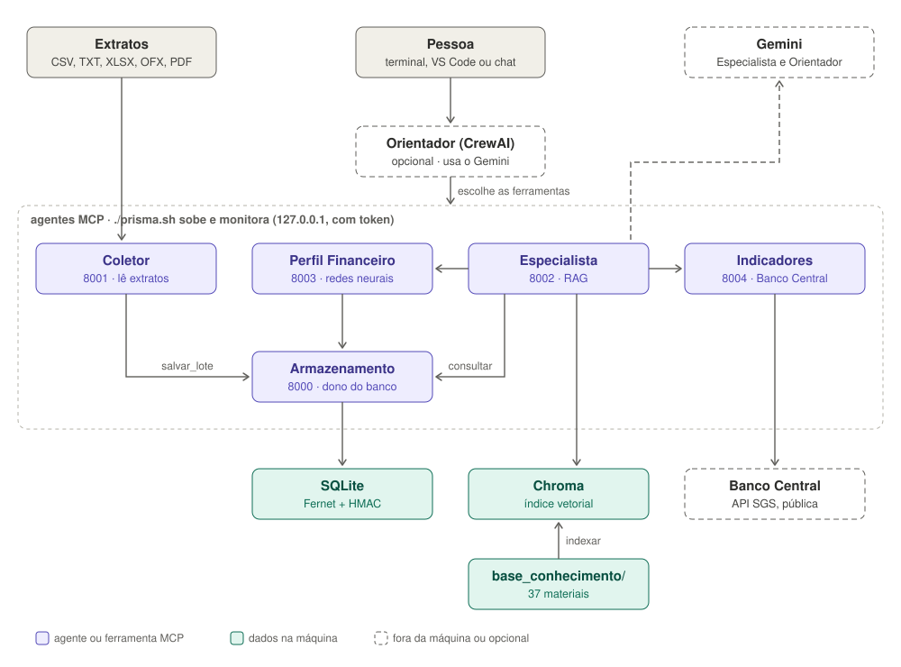
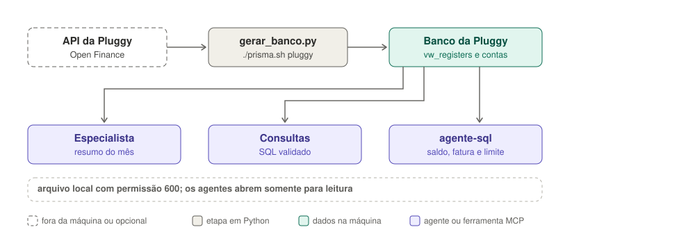

# Prisma

**Organização financeira com agentes de IA, a partir dos seus dados do Open Finance.**

O Prisma reúne as contas e os cartões da pessoa pela **Pluggy** (Open Finance) e oferece agentes que respondem perguntas sobre os gastos, explicam conceitos de educação financeira com fontes e trazem as taxas oficiais do Banco Central. Os números vêm sempre de SQL e de Python; a IA só escreve o texto. As decisões continuam com a pessoa.

> Projeto do **Challenge 2: Bem-estar**. Pergunta norteadora: *a IA vai substituir o humano ou ampliar o seu potencial?* O Prisma aposta na segunda opção: os agentes cuidam da parte mecânica, e a pessoa decide.

| | |
|---|---|
| **Grupo** | Prisma |
| **Integrantes** | Alvaro, Carlos, Kelvin, Mariana, Prisciele, William |
| **Big Idea** | Bem-estar |
| **Status** | MVP em desenvolvimento (branch `development_sprint_02`) |

## As três partes do repositório

| Pasta | O que é | Tecnologia | Documentação |
|---|---|---|---|
| [`PrismaAPP/`](PrismaAPP) | **App Android** de finanças pessoais (Início, Transações, Resumos, Assistente e Ajustes) e o **servidor do assistente** text-to-SQL do app | Kotlin, Jetpack Compose, Room, Hilt · Python, FastAPI, Gemini | [README do app](PrismaAPP/README.md) |
| [`agente-sql/`](agente-sql) | **Download dos dados da Pluggy** para um banco local e um **agente SQL simples**, com métricas e benchmark | Python (biblioteca padrão), MCP | [README do agente-sql](agente-sql/README.md) |
| [`projeto_agentes/`](projeto_agentes) | **Agentes MCP locais**: Especialista (RAG com 37 materiais de educação financeira), Indicadores (Banco Central) e Consultas (SQL validado), com o `prisma.sh` que sobe tudo | Python, MCP, Chroma, Gemini | [README dos agentes](projeto_agentes/README.md) |

## Arquitetura



**Como as partes se conectam:**

- **Uma fonte de dados: a Pluggy.** No celular, o app sincroniza contas e transações para o banco do aparelho (Room). No computador, o `agente-sql` baixa os mesmos dados para `~/.prisma/app/prisma.db`. Os dois bancos têm as mesmas tabelas e a mesma view **`vw_registers`**, uma linha por transação, com categoria em português e os campos prontos `valor_gasto` e `valor_entrada`. Pagamento de fatura e transferências entre contas próprias não contam como gasto.
- **Os agentes leem, nunca gravam.** O banco é aberto somente para leitura por todos os agentes.
- **Os agentes conversam por MCP.** O Especialista pede as taxas do Banco Central ao Agente de Indicadores a cada pergunta. Os agentes também podem ser usados como ferramentas no chat do VS Code em modo agente.
- **O app conversa com o seu assistente.** O app manda a pergunta ao servidor do assistente, recebe o SQL, executa no próprio celular e manda só o resultado para o servidor redigir a resposta. Os dados financeiros ficam no aparelho.
- **Um `.env` único** em `projeto_agentes/` guarda as credenciais da Pluggy, a chave do Gemini e o token do app, e serve aos agentes, ao `agente-sql` e ao servidor do assistente (quando sobe pelo `prisma.sh`).



### Os agentes

| Agente | Onde | Porta | O que responde |
|---|---|---|---|
| **Especialista** | `projeto_agentes/especialista` | 8002 | dúvidas de educação financeira, com fonte e página, e o resumo do mês da pessoa quando ela pede (`--com-dados`) |
| **Indicadores** | `projeto_agentes/indicadores` | 8004 | juros médios do rotativo, do cheque especial e do crédito pessoal, Selic e inflação, direto da API do Banco Central; simula quanto uma dívida cresce |
| **Consultas** | `projeto_agentes/consultas` | 8006 | totais e listas exatas sobre os gastos, com o SQL validado e o guardião que confere todo valor em R$ |
| **agente-sql** | `agente-sql` | stdio | perguntas com SQL simples, incluindo saldo, fatura e limite dos cartões |
| **Assistente do app** | `PrismaAPP/agent` | 8000 ou 8010 | as perguntas feitas na aba Assistente do app |

## Como rodar

### Computador: agentes e dados (Linux ou WSL)

```bash
cd projeto_agentes
./prisma.sh iniciar          # cria o .venv, instala, cria o .env e sobe os 3 agentes
nano .env                    # PLUGGY_CLIENT_ID, PLUGGY_CLIENT_SECRET, PLUGGY_ITEM_IDS e GOOGLE_API_KEY
./prisma.sh pluggy           # baixa contas e transações da Pluggy
./prisma.sh indexar          # monta o índice da base de conhecimento
./prisma.sh reiniciar

./prisma.sh especialista perguntar "Como saio do rotativo?" --com-dados
./prisma.sh consultas perguntar "Quanto gastei com mercado em outubro?"
./prisma.sh sql "Qual meu saldo e quanto tenho de limite?"
./prisma.sh indicadores juros
```

Passo a passo completo, comandos e problemas comuns: [README dos agentes](projeto_agentes/README.md).

### Celular: app Android

1. Suba o servidor do assistente: `./prisma.sh app` (porta 8010, usa o mesmo `.env`) ou pelo [README do app](PrismaAPP/README.md) (porta 8000, com `uv`).
2. Em `PrismaAPP/local.properties`, aponte `assistant.url` para a porta usada (`http\://127.0.0.1\:8010/` ou `\:8000/`) e copie o token para `assistant.token`.
3. Conecte o celular (ou abra o emulador) e rode `adb reverse tcp:<porta> tcp:<porta>`.
4. No Android Studio (Rabbit 2 ou mais novo), clique em **Run 'app'** e informe as credenciais da Pluggy no passo a passo do app.

O app funciona sem o servidor; só a aba **Assistente** depende dele.

### Testes

```bash
cd projeto_agentes && ./prisma.sh testes          # agentes (sem internet)
cd agente-sql && python -m pytest                 # agente-sql e métricas
cd PrismaAPP && ./gradlew test                    # app (testes unitários)
cd PrismaAPP/agent && uv run pytest               # servidor do assistente
```

## Segurança e privacidade

- **Dados reais ficam na máquina ou no celular.** O banco local da Pluggy não vai para o Git (o `.gitignore` da raiz bloqueia `*.db`, `.env` e `config.json`) e é aberto somente para leitura.
- **Segredos só no `.env`** (e no `local.properties` do app). Nunca os cole em chats, issues ou commits.
- **O que sai da máquina:** a Pluggy recebe as credenciais e devolve os dados; o Gemini recebe a pergunta e, para redigir, o resumo do mês ou o resultado do SQL; o Banco Central recebe só códigos de séries.
- **No app**, as credenciais da Pluggy ficam cifradas no Android Keystore, e o servidor do assistente nunca acessa o banco do celular.
- **Guardrails:** SQL validado (um `SELECT`, só na `vw_registers`), filtro de manipulação, execução somente leitura com limite de linhas e tempo, e conferência de todo valor em R$ citado na resposta. Detalhes no README de cada parte.

## Estrutura

```
Prisma/
├── .gitignore            # bloqueia .env, bancos *.db e config.json em todo o repositório
├── PrismaAPP/
│   ├── app/              # app Android (Kotlin, Compose, Room)
│   └── agent/            # servidor do assistente text-to-SQL (FastAPI)
├── agente-sql/           # gerar_banco.py (Pluggy), agente SQL, servidor MCP, métricas e benchmark
└── projeto_agentes/
    ├── especialista/     # RAG, resumo do mês, avaliação da busca
    ├── indicadores/      # API do Banco Central
    ├── consultas/        # SQL validado com o código do assistente do app
    ├── base_conhecimento/
    ├── docs/             # diagramas (python docs/gerar_diagramas.py)
    ├── prisma.sh         # sobe e controla os agentes; pluggy, app, sql
    └── .env.example      # modelo do .env único
```

## Próximos passos

- Notificações dos agentes para o app (mudanças de gasto, variação dos juros).
- Persistir o histórico do orquestrador (hoje fica na memória do processo).
- Medir a busca do Especialista com os modos `local` e `gemini` e revisar a base de conhecimento.

## Branches

| Branch | Conteúdo |
|---|---|
| `development_sprint_02` | versão atual do projeto |
| `main` | será atualizada a partir de `development_sprint_02` por pull request |
| `rede-neural` | experimentos de redes neurais (autoencoder e MLP) da sprint anterior |
