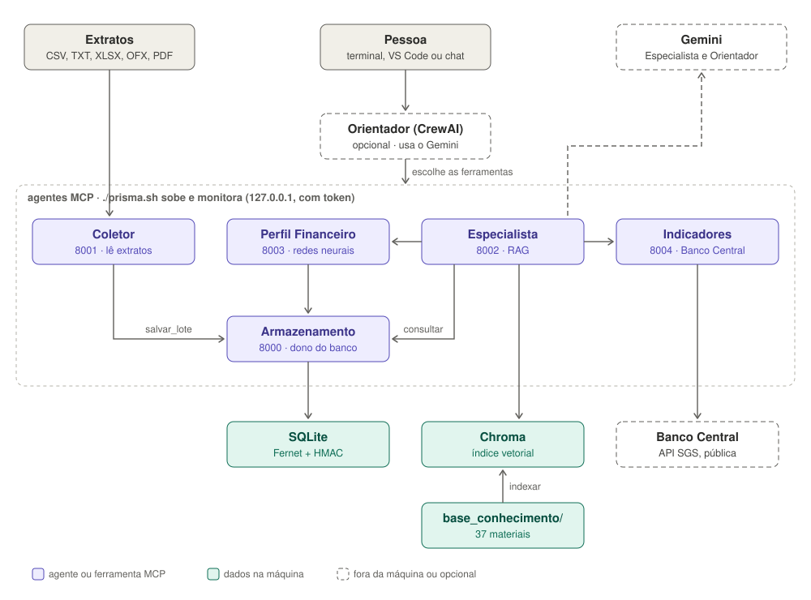
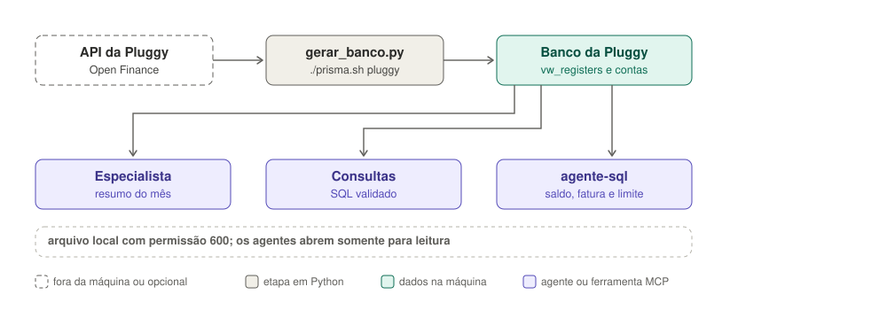
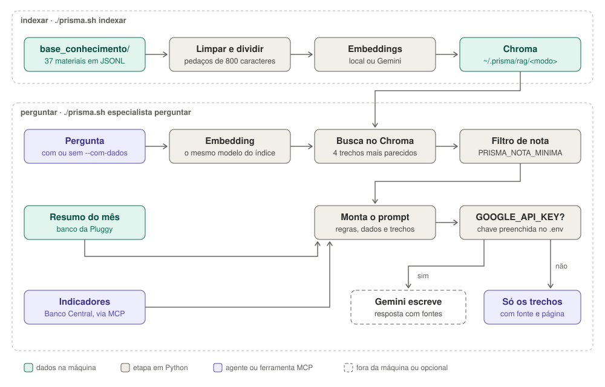
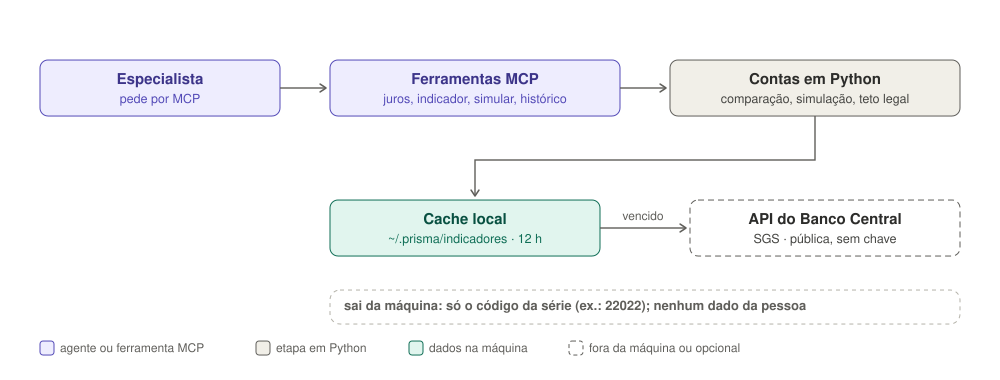
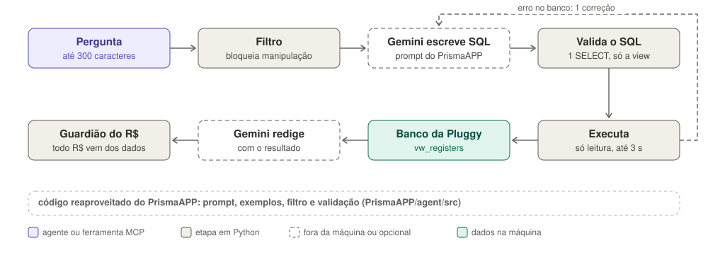
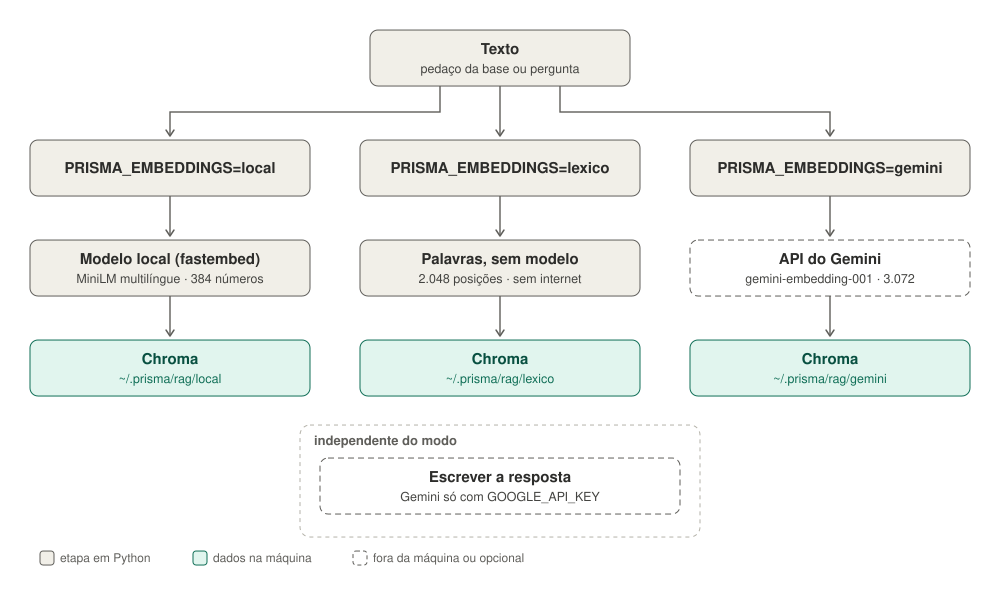

# Prisma

Ferramenta de organização financeira com agentes de IA. Os dados vêm do **Open Finance, pela Pluggy**, ficam num banco local e são consultados por agentes que rodam na sua máquina.

O projeto parte de uma pergunta: a inteligência artificial vai **substituir** o humano ou **ampliar** o seu potencial? O Prisma explora a segunda hipótese. Os agentes cuidam da parte mecânica (buscar os dados, somar, consultar taxas oficiais, achar explicações confiáveis) e as decisões continuam com a pessoa.

> **Status:** MVP em desenvolvimento. Três agentes MCP locais (Especialista, Indicadores e Consultas), o agente-sql com o download da Pluggy e o assistente do PrismaAPP.

## Sumário

- [Sobre o projeto](#sobre-o-projeto)
- [Arquitetura](#arquitetura)
- [Os dados: Pluggy](#os-dados-pluggy)
- [Os agentes](#os-agentes)
- [Modos de embeddings](#modos-de-embeddings)
- [Prompt enviado ao Gemini](#prompt-enviado-ao-gemini)
- [Base de conhecimento](#base-de-conhecimento)
- [Como rodar](#como-rodar)
- [Todos os comandos](#todos-os-comandos)
- [Configuração (.env)](#configuração-env)
- [Segurança e LGPD](#segurança-e-lgpd)
- [Guardrails](#guardrails)
- [Testes](#testes)
- [Estrutura do repositório](#estrutura-do-repositório)
- [Problemas comuns](#problemas-comuns)
- [Limitações e próximos passos](#limitações-e-próximos-passos)

## Sobre o projeto

| | |
|---|---|
| **Grupo** | Prisma |
| **Integrantes** | Alvaro, Carlos, Kelvin, Mariana, Prisciele, William |
| **Big Idea** | Bem-estar |
| **Essential Question** | A IA vai substituir o humano ou ampliar seu potencial? |

**Problema.** Boa parte da população tem dificuldade em planejar as finanças, por falta de conhecimento ou de tempo para manter planilhas. Sem controle, o dinheiro vira fonte de estresse, ansiedade e culpa.

**Hipótese.** O agente amplia o potencial humano em vez de substituí-lo: registra, soma, mede e explica, e a pessoa decide o que cortar, qual meta seguir e quando pagar uma dívida. Ao explicar cada resposta com fonte, o agente ensina educação financeira na prática.

## Arquitetura



| Parte | Porta | O que faz | Usa IA? |
|---|---|---|---|
| **agente-sql** (`../agente-sql`) | — | Baixa contas, cartões e transações da Pluggy para o banco local (`./prisma.sh pluggy`). Também responde perguntas com SQL, incluindo saldo, fatura e limite. | Gemini (só nas perguntas) |
| **Especialista** | 8002 | Responde dúvidas de educação financeira com RAG sobre 37 materiais, usando, se pedido, o resumo do mês da pessoa e as taxas do Banco Central. | Gemini (opcional) |
| **Indicadores** | 8004 | Busca dados oficiais na API pública do Banco Central: juros do rotativo, do cheque especial e do crédito pessoal, Selic e inflação. Simula quanto uma dívida cresce. | Não |
| **Consultas** | 8006 | Responde perguntas exatas sobre os gastos com o assistente text-to-SQL do PrismaAPP: SQL validado, banco somente leitura e conferência dos valores. | Gemini |
| **Assistente do app** (`../PrismaAPP/agent`) | 8010 | Servidor do assistente do app Android; o app executa o SQL no próprio celular. | Gemini |

Três princípios guiam o desenho:

1. **Uma fonte de dados.** Tudo vem da Pluggy. O banco local tem as mesmas tabelas e a mesma view `vw_registers` do PrismaAPP, e os agentes só o abrem **para leitura**.
2. **Números vêm do SQL e do Python.** Somas, saldos e taxas são calculados em código ou vêm do Banco Central. O Gemini, quando usado, só escreve o texto.
3. **Tudo local por padrão.** Os serviços escutam só em `127.0.0.1`, com token. O que sai da máquina está em [Segurança e LGPD](#segurança-e-lgpd).

**Agentes trabalhando juntos.** O Especialista pede as taxas oficiais ao Agente de Indicadores **por MCP**, a cada pergunta, e lê o resumo do mês do banco da Pluggy. Os agentes também podem ser usados como ferramentas por um cliente MCP, como o chat do VS Code em modo agente: o `.vscode/mcp.json` registra os três agentes e o agente-sql, e o chat decide qual chamar.

## Os dados: Pluggy



O `./prisma.sh pluggy` roda o `gerar_banco.py` do agente-sql: ele se autentica na API da Pluggy com o Client ID e o Client Secret, lê as categorias e, para cada banco conectado (`PLUGGY_ITEM_IDS`), as contas, os cartões e todas as transações. O resultado é um SQLite em `~/.prisma/app/prisma.db` com:

- `vw_registers`: uma linha por transação, com data, descrição, categoria em português, conta, banco, parcela e os campos prontos `valor_gasto` (já sem transferências e pagamento de fatura, e com estornos descontados) e `valor_entrada`;
- `account_dim`: saldo de cada conta, fatura atual e limite de cada cartão.

Rodar de novo atualiza o banco. O arquivo fica com permissão `600`, porque contém os seus dados financeiros reais, e nunca vai para o Git.

Também dá para usar o banco do celular: copie o `prisma.db` do app (Android Studio → **Device Explorer** → `/data/data/br.com.prisma.financas/databases/`) para `~/.prisma/app/`. Nesse caso, saldo e limite não ficam disponíveis, porque o app não guarda a `account_dim` da mesma forma.

## Os agentes

### Agente Especialista



Responde dúvidas de educação financeira com RAG (busca numa base de conhecimento) e, quando a pessoa pede, com os números dela.

**Indexar** (`./prisma.sh indexar`), feito uma vez e sempre que a base muda: cada página dos JSONL em `base_conhecimento/` é limpa e dividida em pedaços de até 800 caracteres, com 150 de sobreposição; cada pedaço vira um vetor e vai para o Chroma, com fonte e página. Só o que mudou é reprocessado.

**Perguntar** (`./prisma.sh especialista perguntar "..." [--com-dados]`):

1. A pergunta vira vetor, e o Chroma traz os 4 trechos mais parecidos, cada um com uma nota de 0 a 1. Só passam os que têm nota acima de `PRISMA_NOTA_MINIMA`.
2. O Especialista pede ao **Agente de Indicadores, por MCP**, os juros médios e a Selic.
3. Com `--com-dados`, entra também o **resumo do mês**, calculado com SQL no banco da Pluggy: entradas, gastos, saldo do mês, maiores categorias e saldo, fatura e limite das contas.
4. Com `GOOGLE_API_KEY`, o Gemini escreve a resposta seguindo regras fixas (veja [Prompt enviado ao Gemini](#prompt-enviado-ao-gemini)). Sem a chave, a resposta são os trechos mais próximos, com as fontes.

| Ferramenta MCP | Parâmetros | O que faz |
|---|---|---|
| `buscar_conhecimento` | `pergunta`, `k` (opcional, até 10) | trechos com fonte, página e nota |
| `resumo_do_mes` | `periodo` (opcional, AAAA-MM) | resumo do mês com os dados da Pluggy |
| `perguntar` | `pergunta`, `usar_meus_dados` e `periodo` (opcionais) | resposta com RAG, taxas oficiais e, se pedido, o resumo do mês |
| `status_base` | nenhum | arquivos indexados e pendentes |
| `atualizar_base` | nenhum | indexa o que mudou |

Código: `especialista/rag.py`, `dados.py`, `agente.py`, `log_prompts.py` e `app.py`.

### Agente de Indicadores



Integra o Prisma à **API pública do Banco Central** (SGS, Sistema Gerenciador de Séries Temporais), que é gratuita e não exige chave. Com ele, o Especialista fala de juros com dado oficial e atual, e não com o que está escrito em material antigo.

**Séries usadas** (códigos conferidos no portal de dados abertos do BCB):

| Indicador | Série SGS | Unidade |
|---|---:|---|
| Taxa Selic (meta do Copom) | 432 | % ao ano |
| Inflação (IPCA) no mês / em 12 meses | 433 / 13522 | % |
| Juros do cartão de crédito rotativo, pessoas físicas | 22022 / 25477 | % ao ano / % ao mês |
| Juros do cheque especial, pessoas físicas | 20741 / 25463 | % ao ano / % ao mês |
| Juros do crédito pessoal, pessoas físicas | 20748 | % ao ano |
| Juros médios do crédito para pessoas físicas | 20740 | % ao ano |

As taxas de crédito são **médias das novas operações** de cada mês, divulgadas com algumas semanas de atraso. Não são a taxa do contrato de cada pessoa.

| Ferramenta MCP | Parâmetros | O que faz |
|---|---|---|
| `juros_do_credito` | nenhum | juros médios do rotativo, do cheque especial e do crédito pessoal, comparados com a Selic |
| `indicador` | `nome` | último valor de um indicador, com mês de referência e fonte |
| `simular_custo` | `valor`, `modalidade`, `meses` | quanto uma dívida cresce com a taxa média; no rotativo, respeita o teto legal de 100% do valor original (Lei 14.690/2023) |
| `historico` | `nome`, `n` (opcional) | últimos valores de um indicador |

Como funciona por dentro:

- **Cache.** As respostas ficam em `~/.prisma/indicadores/cache.json` por 12 horas. Se a API estiver fora do ar, o agente usa o último valor guardado e avisa de quando ele é. Se não houver nada guardado, devolve um erro claro, e o Especialista segue com "(indisponíveis)" no prompt.
- **Privacidade.** Para o Banco Central só vai o código da série (por exemplo, 22022). Nenhum dado da pessoa sai da máquina por esse agente.
- **Integração com o Especialista.** A cada `perguntar`, o Especialista pede `juros_do_credito` ao Indicadores por MCP, e o resultado entra no prompt na seção INDICADORES DO BANCO CENTRAL. Para exemplo, o Banco Central divulgou, para maio de 2026, juros médios de 439,9% ao ano no rotativo e de 138,3% ao ano no cheque especial.

```bash
./prisma.sh indicadores juros                                   # tabela de juros com a Selic
./prisma.sh indicadores ver selic                               # um indicador, em JSON
./prisma.sh especialista perguntar "Como saio do rotativo?" --com-dados
./prisma.sh indicadores historico rotativo -n 12
```

Código: `indicadores/series.py` (códigos das séries), `bcb.py` (API e cache), `consultas.py` (contas) e `app.py`.

### Agente de Consultas



Responde perguntas exatas sobre os gastos: "quanto gastei com mercado em outubro?", "quais foram minhas 5 maiores compras?". Em vez de pedir ao LLM que faça contas, o agente faz o Gemini **escrever uma consulta SQL**, que é validada e executada no banco da Pluggy.

O agente **reaproveita o código do assistente do PrismaAPP** (`PrismaAPP/agent/src/prisma_agent`): o mesmo prompt, os mesmos exemplos, o mesmo filtro de manipulação e a mesma validação de SQL. O que o app faz no celular foi portado para Python:

1. **Filtro de manipulação:** "ignore as instruções", SQL escrito na pergunta e afins são bloqueados sem chamar o modelo.
2. **Gemini escreve o SQL** com o prompt do app, sabendo as categorias, contas e bancos que existem.
3. **Validação:** um único `SELECT`, só na view `vw_registers`, sem comentários, sem `PRAGMA`, `ATTACH` nem escrita.
4. **Execução somente leitura** no banco da Pluggy: no máximo 200 linhas e 3 segundos. Se o banco recusar o SQL, o Gemini tem uma chance de corrigir.
5. **Gemini redige** a resposta a partir do resultado (até 50 linhas).
6. **Guardião do R$:** todo valor em reais citado na resposta precisa existir no resultado; senão, a resposta é descartada e a pessoa recebe a tabela com os dados.

| Ferramenta MCP | Parâmetros | O que faz |
|---|---|---|
| `perguntar_ao_app` | `pergunta` (até 300 caracteres) | resposta, SQL executado e tabela com o resultado |
| `status_app` | nenhum | se o banco da Pluggy e o código do assistente foram encontrados, quantas transações e de que período |

```bash
./prisma.sh consultas status
./prisma.sh especialista resumo
./prisma.sh consultas perguntar "Quanto gastei com mercado em outubro?"
```

Precisa da `GOOGLE_API_KEY`, do código do PrismaAPP (em `../PrismaAPP/agent/src`, ou em `PRISMA_APP_AGENT_SRC`) e do banco da Pluggy. Código: `consultas/motor.py` e `app.py`.

### Orquestrador

Ponto de entrada único, feito com **LangGraph**: recebe a mensagem da pessoa, aplica as barreiras e decide quais agentes chamar, **por MCP**.

```
entrada ──(manipulação)───────────────────────────────────────────► resposta fixa
   ▼ (sem LLM)
classificar ──(fora de finanças / cumprimento)──────────────────────► resposta fixa
   ▼ (Gemini: escopo, destinos, pergunta completa e a parte de cada agente)
dados → agente-sql | conceitos → Especialista | indicadores → Indicadores   (em paralelo, 1 chamada cada)
   ▼
GUARDIÃO: todo R$ e % de cada resposta precisa estar nas evidências que o agente devolveu
   ▼      (senão, o texto é descartado e a pessoa recebe os dados)
sintetizar: 1 agente → a resposta dele; 2 ou mais → o Gemini junta, e o guardião confere de novo
```

- **Guardião único.** Os agentes não conferem as próprias respostas: o orquestrador confere todas, contra as evidências que cada um devolve. O agente-sql devolve as linhas do SQL (`dados`), o Indicadores devolve os dados do Banco Central e o Especialista devolve `evidencias` (os trechos, o resumo do mês e as taxas que entraram no prompt). Arredondar vale (451,71% → 451,7%); somar, calcular ou inventar não.
- **Só finanças.** O que não for finanças é bloqueado com uma mensagem fixa informando que o Prisma não responde a esse assunto. Nenhum agente é chamado.
- **Histórico.** Cada conversa (`conversa_id`) guarda as mensagens; "e em setembro?" vira "Quanto gastei com supermercado em setembro de 2026?".
- **Agente fora do ar** não derruba a resposta: a parte dele vira uma frase dizendo que não foi possível.
- Conecta no Especialista e no Indicadores por HTTP quando estão no ar (`ESPECIALISTA_URL`, `INDICADORES_URL`, definidas pelo `prisma.sh`) e, senão, por stdio; o agente-sql é sempre por stdio.

```bash
./prisma.sh orquestrador chat                                    # conversa no terminal (Windows: .\prisma.ps1 orquestrador chat)
./prisma.sh orquestrador perguntar "qual meu saldo e quanto está o juro do rotativo?" --json
./prisma.sh orquestrador servidor --http --port 8008             # ferramenta MCP conversar(mensagem, conversa_id)
```

Código: `orquestrador/grafo.py` (grafo e prompts), `agentes.py` (chamadas MCP), `guardas.py` e `app.py`. Testes em `tests/test_orquestrador.py`.

### agente-sql

A pasta `agente-sql/` do repositório (ao lado de `projeto_agentes/` e `PrismaAPP/`) é o agente text-to-SQL simples da equipe. Ele faz duas coisas:

- **Baixa os dados da Pluggy** (`gerar_banco.py`): é a fonte de dados de todo o Prisma (veja [Os dados: Pluggy](#os-dados-pluggy)).
- **Responde perguntas com SQL** (`agente.py` e `servidor_mcp.py`, ferramenta MCP `consultar_financas`), incluindo **saldo, fatura atual e limite** dos cartões, que vêm da tabela `account_dim`.

Ele usa o mesmo `.env` único: `GOOGLE_API_KEY`, `GEMINI_MODEL`, `PRISMA_APP_DB` e as credenciais `PLUGGY_CLIENT_ID`, `PLUGGY_CLIENT_SECRET` e `PLUGGY_ITEM_IDS`. Se existir um `agente-sql/config.json`, como no README da pasta, ele continua valendo.

```bash
./prisma.sh pluggy                                   # baixa da Pluggy para ~/.prisma/app/prisma.db
./prisma.sh sql "qual meu saldo e quanto tenho de limite?"
./prisma.sh consultas status                         # o Agente de Consultas usa o banco baixado
```

**Consultas ou agente-sql?** Os dois respondem com SQL sobre os mesmos dados:

| | Agente de Consultas | agente-sql |
|---|---|---|
| Código | assistente do PrismaAPP | agente simples da equipe |
| Fontes | só a `vw_registers` (transações) | `vw_registers` e `account_dim` (também saldo, fatura e limite) |
| Validação do SQL | um único `SELECT`, só na view, sem comentários nem `PRAGMA` (sqlglot) | um único `SELECT`, só `vw_registers`, `account_dim` e `item_dim`, conferido pelo próprio SQLite (`set_authorizer`) |
| Conferência da resposta | todo R$ citado precisa estar no resultado | feita pelo guardião do orquestrador, com as linhas que o agente devolve |
| Servidor | HTTP no `prisma.sh` (porta 8006) | stdio (VS Code e orquestrador) |

O orquestrador usa o agente-sql para os dados da pessoa, porque ele também traz saldo, fatura e limite.

**Métricas do agente-sql.** O agente-sql registra latência e resultado de cada pergunta em `agente-sql/metricas.db` e tem um benchmark próprio com as perguntas de `projeto_agentes/perguntas_respostas_prisma(in).csv`: `cd ../agente-sql && python avaliar.py --hoje 2026-11-25` e `python metricas.py` (detalhes no `agente-sql/README.md`).

### Assistente do PrismaAPP

O servidor do assistente do app Android (`../PrismaAPP/agent`) sobe com o **mesmo `.env`**, na porta 8010:

```bash
./prisma.sh app           # sobe em 127.0.0.1:8010 e, com o celular conectado, faz o adb reverse
./prisma.sh app parar
```

Na primeira vez, o comando gera um `APP_TOKENS` se o atual for curto demais (e, uma única vez, copia as chaves do `.env` antigo do app, se existir). Ele precisa do `uv` (`sudo snap install --classic astral-uv`). O app em si não muda: ele continua lendo o endereço e o token do `local.properties`, na raiz do PrismaAPP:

```properties
assistant.url=http\://127.0.0.1\:8010/
assistant.token=<o valor de APP_TOKENS no .env>
```

Com o celular no cabo USB, o `./prisma.sh app` faz o `adb reverse tcp:8010 tcp:8010` (refaça se o celular reconectar). No emulador, use `assistant.url=http\://10.0.2.2\:8010/`, que dispensa o `adb reverse`. Depois de mudar o `local.properties`, gere o app de novo (**Run 'app'**).

## Modos de embeddings



Embeddings transformam um texto em uma lista de números que representa o seu significado. Textos sobre o mesmo assunto ficam com números parecidos, mesmo com palavras diferentes. O Especialista usa isso duas vezes: no `indexar`, para cada pedaço da base, e no `buscar`/`perguntar`, para a pergunta. O modo é escolhido por `PRISMA_EMBEDDINGS` no `.env`:

| | `local` | `gemini` (padrão) |
|---|---|---|
| Modelo | `paraphrase-multilingual-MiniLM-L12-v2` | `models/gemini-embedding-001` |
| Onde roda | na sua máquina, em CPU, via fastembed (ONNX) | na API do Google |
| Precisa de chave | não | `GOOGLE_API_KEY` |
| Tamanho do vetor | 384 números | 3.072 números |
| Primeira vez | baixa ~220 MB do Hugging Face para `~/.prisma/modelos` | nada a baixar |
| Custo e cota | nenhum | conta na cota da chave, inclusive no `indexar` (~5.500 pedaços) |
| Índice | `~/.prisma/rag/local/` | `~/.prisma/rag/gemini/` |
| O que sai da máquina | nada | todos os textos da base no `indexar` e cada pergunta |

**Escrever a resposta é outra coisa.** O Gemini só escreve a resposta do `perguntar` quando há `GOOGLE_API_KEY`, em qualquer modo. A combinação mais econômica é `PRISMA_EMBEDDINGS=local` com a chave preenchida: a busca fica na máquina, sem gastar cota, e o Gemini é chamado uma vez por pergunta.

| `.env` | Busca | Resposta do `perguntar` |
|---|---|---|
| `PRISMA_EMBEDDINGS=local`, sem chave | local | os trechos encontrados |
| `PRISMA_EMBEDDINGS=local`, com chave | local | texto escrito pelo Gemini |
| sem `PRISMA_EMBEDDINGS` (ou `=gemini`), com chave | Gemini | texto escrito pelo Gemini |

**Terceiro modo, `lexico`: busca por palavras.** Não usa modelo nem internet: cada texto vira um vetor com as palavras e os pares de palavras (sem acentos e sem palavras comuns). Pega sinônimos mal, mas funciona em qualquer máquina, até numa rede que bloqueia o download do modelo local, e é o modo usado para testar a busca sem internet. Use `PRISMA_EMBEDDINGS=lexico`.

**Trocar de modo.** Mude a variável e rode `./prisma.sh indexar` e `./prisma.sh reiniciar`. Cada modo tem o próprio índice, então voltar ao anterior não exige indexar de novo. Trocar o *modelo* de um modo (por exemplo, `PRISMA_MODELO_EMBEDDING_LOCAL`) refaz o índice daquele modo sozinho.

**Modelo local maior.** O MiniLM é pequeno e rápido. Para separar melhor os assuntos, à custa de ~1 GB e de uma indexação mais lenta:

```bash
PRISMA_MODELO_EMBEDDING_LOCAL=sentence-transformers/paraphrase-multilingual-mpnet-base-v2
```

**A nota de cada trecho** é a similaridade de cosseno entre a pergunta e o trecho: perto de 1, mesmo assunto; perto de 0, assuntos diferentes. Cada modelo usa uma escala própria, então calibre `PRISMA_NOTA_MINIMA` sempre que trocar de modo ou de modelo: rode `./prisma.sh especialista buscar` com perguntas que devem achar algo e com uma fora do assunto, e escolha um valor entre as duas faixas. No modo local, os trechos certos para "o que é crédito rotativo" ficaram entre 0,73 e 0,79.

## Prompt enviado ao Gemini

O Especialista chama o Gemini uma única vez por pergunta, com um texto que junta regras fixas, os dados da pessoa (se pedidos), as taxas do Banco Central, os trechos encontrados na base e a pergunta. O modelo do prompt fica em `especialista/agente.py` (`PROMPT`), e o modelo do Gemini em `GEMINI_MODEL`, no `.env`.

### O modelo do prompt

```text
Você é o especialista financeiro do Prisma, um app de bem-estar financeiro. Ajude a pessoa a planejar; a decisão é sempre dela.

Regras:
- Use SOMENTE os números de DADOS DO USUÁRIO e de INDICADORES DO BANCO CENTRAL. Nunca invente valores.
- Para taxas de mercado (juros médios, Selic, inflação), use os INDICADORES DO BANCO CENTRAL, diga que são médias e cite "Banco Central" com o mês de referência.
- Para explicar conceitos, use SOMENTE os TRECHOS DE REFERÊNCIA. Se eles não cobrirem a pergunta, diga que ainda não tem um conteúdo revisado sobre isso.
- Cite a fonte e a página dos trechos que usar, como (fonte, p. N).
- Se dois trechos se contradizem, siga as "Atualizações da equipe" do Prisma, que corrigem materiais antigos, e não repita a informação desatualizada.
- Materiais antigos podem estar desatualizados: se um trecho falar de regra ou lei com data, avise que vale conferir se ainda está em vigor.
- Não recomende produtos financeiros específicos (ações, fundos, bancos). Não julgue gastos.
- Se os gastos do mês passam das entradas, comece acolhendo, sem tom de alarme, e priorize um passo pequeno e possível.
- Responda em português do Brasil, curto, com valores como R$ 1.234,56.

## DADOS DO USUÁRIO
{dados}

## INDICADORES DO BANCO CENTRAL
{indicadores}

## TRECHOS DE REFERÊNCIA
{trechos}

## PERGUNTA
{pergunta}
```

| Campo | O que entra | Quando está vazio |
|---|---|---|
| `{dados}` | resumo do mês, calculado com SQL no banco da Pluggy: entradas, gastos, saldo do mês, maiores categorias, saldo e limite das contas | sem `--com-dados`: `(não informados)` |
| `{indicadores}` | juros médios do rotativo, do cheque especial e do crédito pessoal, e a Selic, pedidos ao Agente de Indicadores | API do Banco Central fora do ar e sem cache: `(indisponíveis)` |
| `{trechos}` | os trechos com nota acima de `PRISMA_NOTA_MINIMA`, no formato `[fonte, p. N] texto` | nenhum trecho passou: `(nenhum trecho relevante)` |
| `{pergunta}` | a pergunta, como foi digitada | nunca |

### Por que cada regra existe

| Regra | Motivo |
|---|---|
| Só os números dos dados e dos indicadores | o Gemini não faz contas: os números vêm do SQL, do Python e do Banco Central |
| Taxas de mercado com fonte e mês | a pessoa sabe que é uma média oficial, e de quando |
| Só os conceitos dos trechos | evita respostas de memória, que podem estar erradas ou desatualizadas |
| Citar fonte e página | a pessoa pode conferir, e a resposta vira educação financeira com referência |
| Seguir as atualizações da equipe | materiais antigos da base têm regras que mudaram (por exemplo, o mínimo de 15% do cartão) |
| Não recomendar produtos, não julgar gastos | o Prisma ajuda a planejar; não é recomendação de investimento |
| Acolher quando os gastos passam das entradas | o tom importa para quem está apertado |

### O que volta

Com a chave, o Especialista devolve o texto do Gemini e as fontes dos trechos usados. Sem a chave (ou sem internet, ou com a cota esgotada), devolve os trechos mais próximos, com as fontes:

```json
{
  "resposta": "Não consegui gerar a resposta agora. Estes são os trechos mais próximos da sua pergunta.",
  "trechos": [
    {"fonte": "FEBRABAN (Meu Bolso em Dia), Guia do Cartão de Crédito", "pagina": 10, "nota": 0.785, "texto": "O que é crédito rotativo? ..."}
  ],
  "fontes": ["FEBRABAN (Meu Bolso em Dia), Guia do Cartão de Crédito, p. 10"],
  "gerado_por": "sem Gemini (GOOGLE_API_KEY não definida)"
}
```

### Registro dos prompts

Cada `perguntar` fica registrado em `~/.prisma/logs/prompts.jsonl`, uma linha JSON por pergunta, com:

| Campo | Conteúdo |
|---|---|
| `quando` | data e hora |
| `pergunta` | a pergunta, como foi digitada |
| `modelo` | o modelo do Gemini configurado |
| `enviado_ao_gemini` | `true` se o Gemini foi chamado; `false` se faltou chave, internet ou cota |
| `trechos` | os 4 trechos encontrados, com fonte, página, nota e se passaram da nota mínima |
| `prompt` | o texto exato que foi (ou iria) para o Gemini |
| `resposta` | o que o Especialista devolveu |
| `gerado_por`, `segundos` | quem gerou a resposta e quanto tempo levou |

O prompt é registrado mesmo sem a chave do Gemini, para dar para ver o que seria enviado. Para consultar:

```bash
./prisma.sh especialista prompts            # o último, legível
./prisma.sh especialista prompts -n 5       # os 5 últimos
./prisma.sh especialista prompts --json     # o registro completo em JSON
```

O arquivo fica só na sua máquina, com permissão `600`, e passa para `prompts.jsonl.1` ao chegar a 20 MB. Com `--com-dados`, ele contém o resumo do mês da pessoa: trate-o como dado pessoal. Para desligar o registro, use `PRISMA_LOG_PROMPTS=0` no `.env`.

## Base de conhecimento

São 37 materiais em `base_conhecimento/`, um JSONL por material, extraídos de PDFs públicos (OCR ou texto), de instituições como BCB, CVM, FEBRABAN, Senacon e Enap. Cada linha é uma página:

```json
{"arquivo": "Guia.pdf", "pagina": 10, "metodo": "OCR", "texto": "..."}
```

**Para manter a base**, coloque, troque ou apague arquivos na pasta, registre o título e a instituição em `base_conhecimento/fontes.json` e rode `./prisma.sh indexar`. Só o que mudou é reprocessado. Se a cota do Gemini estourar, ele espera e continua; se for interrompido, rodar de novo retoma de onde parou. `indexar --refazer` refaz tudo.

Quase metade dos pedaços (2.572 de 5.528) vem de livros técnicos da CVM, sobre mercado de capitais e derivativos.

Ficam de fora: subpastas, arquivos com `backup` no nome, cópias idênticas, páginas com `"incluir_no_chunking": false` e páginas com menos de 80 caracteres.

**Materiais desatualizados** não são editados. O arquivo `atualizacoes-da-equipe.jsonl` traz correções com data, e o Especialista é instruído a segui-las quando houver conflito. Hoje ele corrige duas regras do Guia do Cartão de Crédito da FEBRABAN: o teto de juros do rotativo (Lei 14.690/2023) e o pagamento mínimo, que deixou de ser fixado em 15% em 2018.

Os materiais pertencem às instituições que os publicaram. Confirme se a licença de cada um permite republicar o texto extraído em um repositório público.

### Testar a busca

A pasta `especialista/` traz um conjunto de perguntas de teste (`perguntas_teste.jsonl`): 18 perguntas de finanças, cada uma com os materiais da base que a respondem, e 4 perguntas fora do tema (futebol, receita, pneu, Copa). O comando abaixo mede a busca com o índice e o modo atuais:

```bash
./prisma.sh especialista avaliar          # tabela legível
./prisma.sh especialista avaliar --json   # resultado completo
```

Ele mostra, para cada pergunta, em que posição veio o material certo e a nota do 1º trecho. No fim, mostra o resumo: acerto no 1º trecho, acerto entre os 4, MRR (1,0 = sempre em 1º), as faixas de nota dos acertos e das perguntas fora do tema, e uma **sugestão de `PRISMA_NOTA_MINIMA`** que separa os dois grupos.

Resultado no modo `lexico`, com a base atual:

| Medida | Resultado |
|---|---|
| Acerto no 1º trecho | 67% (12 de 18) |
| Acerto entre os 4 primeiros | 83% (15 de 18) |
| MRR | 0,74 |
| Notas dos acertos / fora do tema | 0,226 a 0,489 / 0,115 a 0,164 |
| Nota mínima sugerida | 0,195 |

Os três erros mostram o limite da busca por palavras: em "Como saio do rotativo?", a palavra "saio" não aparece nos materiais, que falam em "sair"; em "inflação" e "desperdício", guias parecidos vieram antes do material certo. A mesma pergunta escrita como "crédito rotativo" acha o Guia do Cartão de Crédito. Note que, nesse modo, a nota mínima padrão (0,5) descartaria quase todos os trechos: **cada modo tem a sua escala**, então rode o `avaliar` e ajuste `PRISMA_NOTA_MINIMA` sempre que trocar de modo. Os modos `local` e `gemini` entendem sinônimos e devem acertar mais; para comparar, rode o mesmo comando depois de indexar em cada modo.

Para acrescentar perguntas, inclua linhas no arquivo no formato `{"pergunta": "...", "esperado": ["nome-do-arquivo-da-base"]}`, com `"esperado": []` para perguntas fora do tema.

## Como rodar

### Requisitos

- Linux ou WSL (com o `prisma.sh`) ou **Windows** (com o `prisma.ps1`, veja [No Windows](#no-windows)).
- **Python 3.10 ou mais novo** (o `prisma.sh` procura `python3.12`, `python3.11` ou `python3.10`).
- O repositório com as três pastas lado a lado: `projeto_agentes/`, `PrismaAPP/` e `agente-sql/`.
- Credenciais da Pluggy (Client ID, Client Secret e o itemId de cada banco) e, para as respostas escritas, uma chave do Gemini (aistudio.google.com).
- Para o app: Android Studio Rabbit 2 (2026.2.2) ou mais novo e `uv` (`sudo snap install --classic astral-uv`).

### Passo a passo

**1. Suba os agentes** (na 1ª vez cria o `.venv`, instala tudo e cria o `.env`):

```bash
cd Prisma/projeto_agentes
./prisma.sh iniciar
```

**2. Preencha o `.env`** e confira sem expor segredos:

```bash
nano .env          # GOOGLE_API_KEY, PLUGGY_CLIENT_ID, PLUGGY_CLIENT_SECRET, PLUGGY_ITEM_IDS
./prisma.sh env
```

**3. Baixe os dados e prepare a base:**

```bash
./prisma.sh pluggy           # contas, cartões e transações da Pluggy
./prisma.sh indexar          # base de conhecimento (a 1ª vez demora)
./prisma.sh especialista avaliar   # confere a busca e sugere a PRISMA_NOTA_MINIMA
./prisma.sh reiniciar
```

**4. Use:**

```bash
./prisma.sh consultas perguntar "Quanto gastei com mercado em outubro?"
./prisma.sh sql "Qual meu saldo e quanto tenho de limite?"
./prisma.sh indicadores juros
./prisma.sh indicadores simular --valor 1000 --modalidade rotativo --meses 3
```

**5. App Android (opcional):** `./prisma.sh app`, conecte o celular (ou abra o emulador) e clique em **Run 'app'** no Android Studio.

No dia a dia: `./prisma.sh iniciar`, `./prisma.sh pluggy` quando quiser dados novos, e `./prisma.sh parar` no fim.

### No Windows

O `prisma.ps1` faz no Windows o mesmo que o `prisma.sh` faz no Linux, pelo PowerShell ou pelo terminal do VS Code, sem WSL. Os comandos são os mesmos:

```powershell
cd projeto_agentes
.\prisma.ps1 iniciar          # cria o .venv, instala, cria o .env e sobe os 3 agentes
notepad .env                  # PLUGGY_*, GOOGLE_API_KEY
.\prisma.ps1 pluggy
.\prisma.ps1 indexar
.\prisma.ps1 reiniciar
.\prisma.ps1 especialista perguntar "Como saio do rotativo?" --com-dados
.\prisma.ps1 consultas perguntar "Quanto gastei com mercado em outubro?"
.\prisma.ps1 sql "Qual meu saldo?"
.\prisma.ps1 status
.\prisma.ps1 parar
```

Antes, instale o **Python 3.12** pelo python.org (marque "Add python.exe to PATH") e desligue o atalho da Microsoft Store em **Configurações → Aplicativos → Configurações avançadas → Aliases de execução do aplicativo → python.exe**. Para o assistente do app (`.\prisma.ps1 app`), instale o `uv`: `winget install astral-sh.uv`.

Se o PowerShell bloquear o script, rode uma vez `Set-ExecutionPolicy -Scope CurrentUser RemoteSigned`, ou chame com `powershell -ExecutionPolicy Bypass -File .\prisma.ps1 iniciar`.

**No VS Code (Windows, Linux ou WSL)**, não precisa digitar nada: **Ctrl+Shift+P → Tasks: Run Task** lista as tarefas do `.vscode/tasks.json` (iniciar, parar, status, Pluggy, indexar, testes, perguntar ao Especialista, Consultas, agente-sql, Indicadores e o assistente do app). Cada tarefa usa o `prisma.sh` no Linux e o `prisma.ps1` no Windows. As que fazem perguntas pedem o texto numa caixa.

No Windows, o `prisma.ps1 iniciar` também cria uma cópia do Python do `.venv` em `.venv\bin\python.exe`, o caminho que o `.vscode/mcp.json` usa, para o chat do VS Code em modo agente achar os agentes nos dois sistemas. Se o chat não os encontrar, selecione o interpretador manualmente (**Python: Select Interpreter → .venv\Scripts\python.exe**).

### VS Code

A pasta `.vscode/` já vem pronta: as **tarefas** (Ctrl+Shift+P → Tasks: Run Task) rodam os comandos do `prisma.sh`/`prisma.ps1`, o painel **Executar e Depurar** tem uma configuração para cada comando principal, e o `.vscode/mcp.json` registra o orquestrador, o Especialista, o Indicadores, o Consultas e o agente-sql para o chat em modo agente. Selecione o interpretador `./.venv/bin/python`.

## Todos os comandos

Todos rodam em `projeto_agentes/`. `./prisma.sh <agente> ...` usa o Python do `.venv` e equivale a `python -m <agente> ...`. Cada comando mostra a própria ajuda com `--help`.

| Comando | O que faz |
|---|---|
| `./prisma.sh iniciar` (ou só `./prisma.sh`) | prepara venv, dependências e `.env` e sobe os 3 agentes |
| `./prisma.sh parar` / `reiniciar` / `status` | para, reinicia ou mostra quem está no ar |
| `./prisma.sh logs [agente]` | acompanha os logs (em `.run/`) |
| `./prisma.sh liberar` | derruba agentes do Prisma que ocupam as portas (ex.: de outra pasta) |
| `./prisma.sh env` | mostra a configuração única, sem expor segredos |
| `./prisma.sh pluggy` | baixa contas e transações da Pluggy para `~/.prisma/app/prisma.db` |
| `./prisma.sh sql "<pergunta>"` | pergunta ao agente-sql (inclui saldo, fatura e limite) |
| `./prisma.sh indexar` | atualiza o índice da base de conhecimento |
| `./prisma.sh app [parar]` | assistente do PrismaAPP na porta 8010, com o mesmo `.env` |
| `./prisma.sh testes` | roda os testes |
| `./prisma.sh ajuda` | mostra a ajuda |

| Agente | Comando | O que faz |
|---|---|---|
| Especialista | `./prisma.sh especialista status` / `indexar [--refazer]` | estado e manutenção do índice |
| Especialista | `./prisma.sh especialista buscar "<pergunta>" [-k 4]` | trechos mais relevantes, com nota |
| Especialista | `./prisma.sh especialista resumo [--periodo AAAA-MM]` | resumo do mês (dados da Pluggy) |
| Especialista | `./prisma.sh especialista perguntar "<pergunta>" [--com-dados] [--periodo AAAA-MM]` | resposta com RAG, taxas oficiais e, se pedido, o resumo do mês |
| Especialista | `./prisma.sh especialista prompts [-n 1] [--json]` | últimos prompts registrados |
| Especialista | `./prisma.sh especialista avaliar [-k 4] [--json]` | mede a busca com as perguntas de teste e sugere a nota mínima |
| Indicadores | `./prisma.sh indicadores juros` / `ver <nome>` / `historico <nome> [-n 12]` | taxas do Banco Central |
| Indicadores | `./prisma.sh indicadores simular --valor 1000 --modalidade rotativo --meses 3` | quanto a dívida cresce |
| Consultas | `./prisma.sh consultas status` / `perguntar "<pergunta>"` | perguntas com SQL validado |
| todos | `./prisma.sh <agente> servidor --http [--port N]` | sobe um agente como serviço HTTP |

| Agente | Ferramenta MCP | O que faz |
|---|---|---|
| Especialista | `buscar_conhecimento`, `resumo_do_mes`, `perguntar`, `status_base`, `atualizar_base` | RAG, resumo do mês e respostas |
| Indicadores | `juros_do_credito`, `indicador`, `simular_custo`, `historico` | dados do Banco Central |
| Consultas | `perguntar_ao_app`, `status_app` | SQL validado sobre o banco da Pluggy |
| agente-sql | `consultar_financas` | SQL simples, com saldo, fatura e limite |

## Configuração (.env)

Um único `.env`, em `projeto_agentes/`, serve ao projeto inteiro: os agentes, o agente-sql e o assistente do PrismaAPP. Ele não vai para o Git e é criado com permissão `600`. Para conferir: `./prisma.sh env`.

| Variável | Para quê | Padrão |
|---|---|---|
| `GOOGLE_API_KEY` | chave do Gemini | vazia |
| `GEMINI_MODEL` | modelo do Gemini (Prisma, agente-sql e assistente do app) | `gemini-3.5-flash-lite` |
| `LLM_TIMEOUT_S` | tempo máximo de uma chamada ao Gemini | `40` |
| `PRISMA_EMBEDDINGS` | `local` (modelo na máquina), `gemini` ou `lexico` (por palavras, sem modelo) | `gemini` |
| `PLUGGY_CLIENT_ID`, `PLUGGY_CLIENT_SECRET`, `PLUGGY_ITEM_IDS` | credenciais da Pluggy e bancos conectados (separados por vírgula) | vazias |
| `PRISMA_APP_DB` | banco da Pluggy | `~/.prisma/app/prisma.db` |
| `APP_TOKENS` | token que o app envia ao assistente | gerado pelo `./prisma.sh app` |
| `LIMITE_POR_MINUTO`, `LIMITE_PERGUNTAS_POR_DIA` | limites do assistente do app | `20`, `100` |
| `PRISMA_NOTA_MINIMA` | nota mínima para um trecho ir ao Gemini | `0.5` |
| `PRISMA_LOG_PROMPTS` | `0` desliga o registro dos prompts | `1` |
| `PRISMA_DIR` | pasta de dados (token, banco, índice, logs) | `~/.prisma` |
| `PORTA_ESPECIALISTA`, `PORTA_INDICADORES`, `PORTA_CONSULTAS`, `PORTA_APP` | portas | `8002`, `8004`, `8006`, `8010` |
| `PRISMA_APP_DIR`, `PRISMA_SQL_DIR`, `PRISMA_APP_AGENT_SRC` | pastas do PrismaAPP, do agente-sql e do código do assistente | `../PrismaAPP`, `../agente-sql`, `../PrismaAPP/agent/src` |

Em `~/.prisma`: `chaves.json` (token dos serviços), `app/prisma.db` (dados da Pluggy), `rag/` (índices), `modelos/` (modelo local de embeddings), `indicadores/` (cache do Banco Central) e `logs/prompts.jsonl`.

## Segurança e LGPD

- **Dados reais num arquivo local.** O banco da Pluggy (`~/.prisma/app/prisma.db`) **não é criptografado**: fica fora do repositório, com permissão `600`, e os agentes o abrem só para leitura. Proteja a sua conta do computador e não copie esse arquivo para outros lugares. Para apagar tudo, `rm ~/.prisma/app/prisma.db*`.
- **Rede.** Os agentes escutam só em `127.0.0.1` e exigem o token; o `/health` de cada um é aberto.
- **Segredos.** As credenciais da Pluggy e a chave do Gemini ficam só no `.env`; o `.gitignore` da raiz ignora `.env`, `config.json` e bancos `*.db`.
- **O que sai da máquina:**
  - a **Pluggy** recebe as credenciais e devolve os seus dados (é a fonte);
  - o **Gemini** recebe, no Especialista, a pergunta, os trechos da base e, com `--com-dados`, o resumo do mês; no Consultas e no agente-sql, a pergunta, a descrição das tabelas e até 50 ou 200 linhas do resultado do SQL;
  - o **Banco Central** recebe só os códigos das séries.

## Guardrails

| Guardrail | Onde |
|---|---|
| Especialista: só os números dos dados e dos indicadores; nunca inventar valores | prompt do Especialista |
| Especialista: explicar só com os trechos da base, citando fonte e página; seguir as atualizações da equipe | prompt + `atualizacoes-da-equipe.jsonl` |
| Especialista: não recomendar produtos, não julgar gastos | prompt do Especialista |
| Especialista: filtro de nota mínima dos trechos; dados da pessoa só vão ao Gemini com `--com-dados` | `especialista/` |
| Números vêm do SQL e do Python; o Gemini só escreve o SQL e o texto | Especialista, Consultas, agente-sql |
| Banco da Pluggy aberto somente leitura (`mode=ro` e `query_only`) | Especialista, Consultas, agente-sql |
| Consultas: filtro de manipulação, SQL validado (um `SELECT`, só a view), 200 linhas e 3 s | `consultas/motor.py` + `PrismaAPP/agent` |
| Consultas: todo valor em R$ da resposta precisa existir no resultado | `consultas/motor.py` |
| agente-sql: SQL conferido pelo SQLite (só as fontes permitidas), 5 s, 200 linhas e 1 correção | `../agente-sql/guardas.py` |
| Orquestrador: filtro de manipulação e bloqueio do que não for finanças | `orquestrador/guardas.py` + classificador |
| Orquestrador (guardião único): todo R$ e % de cada resposta precisa estar nas evidências do agente | `orquestrador/guardas.py` |
| Banco Central: só códigos de série saem; cache de 12 h com aviso de dado antigo | `indicadores/bcb.py` |
| Simulação do rotativo respeita o teto legal e avisa que é estimativa | `indicadores/consultas.py` |
| Serviços só em `127.0.0.1`, com token; `.env` e bancos fora do Git | `comum/servidor_http.py`, `.gitignore` |

O que ainda falta: uma defesa mais forte contra prompt injection (os filtros atuais pegam só as tentativas óbvias) e persistir o histórico do orquestrador.

## Testes

```bash
./prisma.sh testes
```

Rodam sem internet, com índice e bancos descartáveis, embeddings falsos e um Gemini falso. Cobrem a manutenção da RAG, a busca por palavras, a avaliação da busca, o resumo do mês no banco da Pluggy, o Agente de Indicadores (com a API do Banco Central simulada), o Agente de Consultas (com o código do PrismaAPP) e o agente-sql (configuração pelo `.env` e download da Pluggy simulado, compatível com o Consultas e o Especialista).

## Estrutura do repositório

```
Prisma/
├── projeto_agentes/   # este projeto: os agentes, o prisma.sh e o .env único
├── PrismaAPP/         # app Android (app/) e servidor do assistente text-to-SQL (agent/)
└── agente-sql/        # download da Pluggy (gerar_banco.py) e agente SQL simples
```

```
projeto_agentes/
├── especialista/          # RAG (rag.py), resumo do mês (dados.py), prompt (agente.py), registro, MCP
├── indicadores/           # API do Banco Central com cache, simulação e MCP
├── consultas/             # text-to-SQL do PrismaAPP sobre o banco da Pluggy, com MCP
├── comum/                 # .env, token, cliente MCP e servidor HTTP com token
├── base_conhecimento/     # 37 materiais em JSONL + fontes.json + atualizações da equipe
├── docs/                  # diagramas (gerados por docs/gerar_diagramas.py)
├── perguntas_respostas_prisma(in).csv   # benchmark do agente-sql (agente-sql/avaliar.py)
├── tests/
├── .vscode/               # execução, depuração e MCP no VS Code
├── prisma.sh              # sobe, para e monitora os agentes; pluggy, app, sql (Linux/WSL)
├── prisma.ps1             # o mesmo, para Windows (PowerShell)
├── .env.example           # modelo do .env único
└── requirements.txt
```

## Problemas comuns

| Sintoma | Causa e solução |
|---|---|
| `Banco da Pluggy não encontrado` | Rode `./prisma.sh pluggy` (ou copie o `prisma.db` do celular para `~/.prisma/app/`). |
| `Faltam as credenciais da Pluggy` | Preencha `PLUGGY_CLIENT_ID`, `PLUGGY_CLIENT_SECRET` e `PLUGGY_ITEM_IDS` no `.env`. |
| `Erro 401 da Pluggy em /auth` | Client ID ou Client Secret errados. Confira no painel da Pluggy. |
| `SyntaxError` com `python2.7` | O venv não está ativado. Use `./prisma.sh <agente> ...`. |
| `GOOGLE_API_KEY não definida` | Coloque a chave no `.env`. Para a busca do Especialista sem chave, use `PRISMA_EMBEDDINGS=local`. |
| `Chroma requires sqlite3 >= 3.35.0` | SQLite antigo do sistema; o `pysqlite3-binary` resolve: rode `./prisma.sh reiniciar`. |
| `A porta 80xx está ocupada por um programa de outro usuário` | Algo foi iniciado com `sudo`. Pare-o e use só o `./prisma.sh`. |
| `Não encontrei o assistente do PrismaAPP` | Defina `PRISMA_APP_AGENT_SRC` com o caminho de `PrismaAPP/agent/src`. |
| No app: assistente indisponível | Confira `./prisma.sh status` (assistente na 8010) e o `adb reverse tcp:8010 tcp:8010`; no emulador, use `http://10.0.2.2:8010/`. |
| No app: erro 401 | O token do app é diferente do `APP_TOKENS`: gere o app de novo (**Run 'app'**). |
| `Falta o uv` | `sudo snap install --classic astral-uv` |

## Limitações e próximos passos

- O banco da Pluggy não é criptografado; a proteção é o arquivo local com permissão `600` e o acesso somente leitura.
- As taxas do Banco Central são médias de mercado, divulgadas com algumas semanas de atraso, e não a taxa do contrato da pessoa.
- A qualidade da busca do Especialista ainda não foi medida com o Gemini, e quase metade dos pedaços da base vem de livros técnicos da CVM.
- O Agente de Consultas depende da estrutura do código do assistente do PrismaAPP.
- Próximos passos: notificações dos agentes para o app (mudanças de gasto, juros), histórico persistente no orquestrador e revisão da base de conhecimento.
